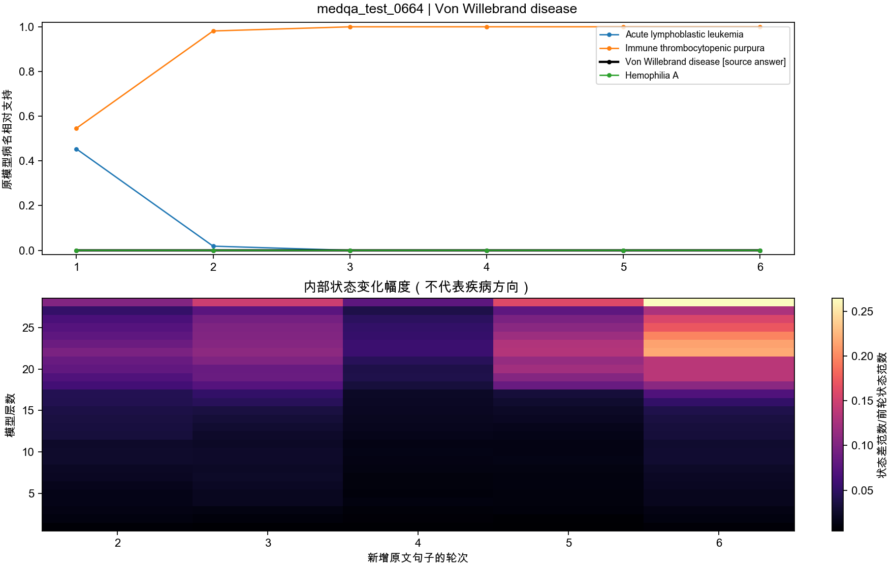

# medqa_test_0664：Von Willebrand disease

来源：MedQA四选项test，第664行（零起始）。来源答案只用于完整题目评价。路径：始终固定另一病。下图没有用DDxPlus探针解码MedQA病名。

Which of the following is the most likely diagnosis in this patient?

| 轮 | 原模型首选 | 来源答案支持 | 本轮新增原文 |
|---|---|---:|---|
| 1 | Immune thrombocytopenic purpura | 0.0000 | A 9-year-old boy is brought in by his mother because of bruising on his torso and limbs. |
| 2 | Immune thrombocytopenic purpura | 0.0000 | The patient’s mother denies any other symptoms and says he is otherwise healthy. |
| 3 | Immune thrombocytopenic purpura | 0.0000 | Physical examination shows multiple petechiae and bruising on the torso and extremities bilaterally. |
| 4 | Immune thrombocytopenic purpura | 0.0000 | The remainder of the physical exam is unremarkable. |
| 5 | Immune thrombocytopenic purpura | 0.0000 | A complete blood count is normal. |
| 6 | Immune thrombocytopenic purpura | 0.0001 | His coagulation profile reveals:
Prothrombin time (PT) 12 sec
Activated partial thromboplastin time (aPTT) 60 sec |

| 完整题目控制 | 原模型首选 | 来源答案支持改变 |
|---|---|---:|
| reverse | Immune thrombocytopenic purpura | -0.0001 |
| shuffle | Immune thrombocytopenic purpura | +0.0636 |
| wrong_history | Immune thrombocytopenic purpura | -0.0001 |

原题选项：{"A": "Acute lymphoblastic leukemia", "B": "Immune thrombocytopenic purpura", "C": "Von Willebrand disease", "D": "Hemophilia A"}
