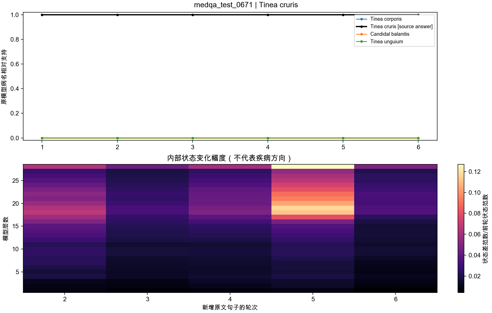

# medqa_test_0671：Tinea cruris

来源：MedQA四选项test，第671行（零起始）。来源答案只用于完整题目评价。路径：始终首选来源病。下图没有用DDxPlus探针解码MedQA病名。

Which of the following is the most likely diagnosis?

| 轮 | 原模型首选 | 来源答案支持 | 本轮新增原文 |
|---|---|---:|---|
| 1 | Tinea cruris | 1.0000 | A 19-year-old man with a past medical history significant only for facial acne presents with increased inguinal pruritis. |
| 2 | Tinea cruris | 1.0000 | Relevant social history includes participation in school wrestling. |
| 3 | Tinea cruris | 1.0000 | He has no significant family history. |
| 4 | Tinea cruris | 1.0000 | Other than the pruritic rash, a review of systems is negative. |
| 5 | Tinea cruris | 1.0000 | On physical examination, there is an erythematous, well-demarcated patch on his left thigh, over his pubic region, and throughout the perineum. |
| 6 | Tinea cruris | 1.0000 | The scrotum is spared. |

| 完整题目控制 | 原模型首选 | 来源答案支持改变 |
|---|---|---:|
| reverse | Tinea cruris | -0.0000 |
| shuffle | Tinea cruris | -0.0000 |
| wrong_history | Tinea cruris | -0.0000 |

原题选项：{"A": "Tinea corporis", "B": "Tinea cruris", "C": "Candidal balanitis", "D": "Tinea unguium"}
