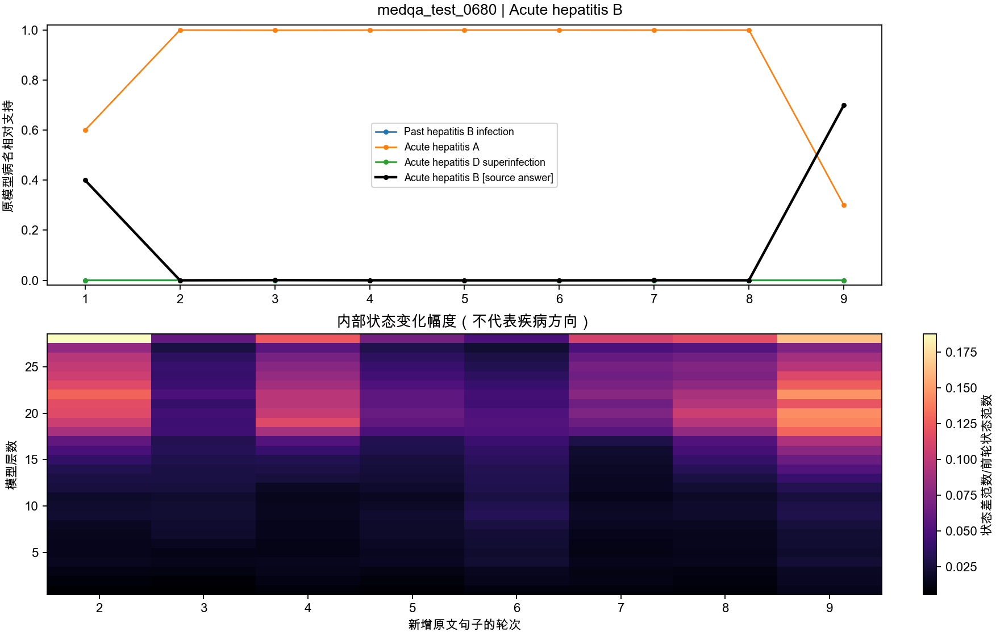

# medqa_test_0680：Acute hepatitis B

来源：MedQA四选项test，第680行（零起始）。来源答案只用于完整题目评价。路径：转向来源病后保持。下图没有用DDxPlus探针解码MedQA病名。

What is the most likely diagnosis?

| 轮 | 原模型首选 | 来源答案支持 | 本轮新增原文 |
|---|---|---:|---|
| 1 | Acute hepatitis A | 0.3998 | A 25-year-old man presents to the office because of extreme fatigue for the past 2 days. |
| 2 | Acute hepatitis A | 0.0001 | He is also worried about his skin looking yellow. |
| 3 | Acute hepatitis A | 0.0008 | He does not have any other complaints and denies fever and headache. |
| 4 | Acute hepatitis A | 0.0003 | He admits to using illicit intravenous drugs in the past. |
| 5 | Acute hepatitis A | 0.0000 | He does not have any immunization records because he moved from Africa to the US at the age of 18. |
| 6 | Acute hepatitis A | 0.0000 | His vital signs are as follows: heart rate 72/min, respiratory rate 14/min, temperature 37.9°C (100.2°F), and blood pressure 100/74 mm Hg. |
| 7 | Acute hepatitis A | 0.0003 | Physical examination is not significant except for mild diffuse abdominal tenderness. |
| 8 | Acute hepatitis A | 0.0001 | His blood is drawn for routine tests and shows an alanine aminotransferase level (ALT) of 2,000 IU/L. |
| 9 | Acute hepatitis B | 0.6992 | A hepatitis viral panel is ordered which shows:
Anti-HAV IgM negative
HBsAg positive
Anti-HBs negative
IgM anti-HBc positive
Anti-HCV negative
Anti-HDV negative |

| 完整题目控制 | 原模型首选 | 来源答案支持改变 |
|---|---|---:|
| reverse | Acute hepatitis A | -0.6990 |
| shuffle | Acute hepatitis B | +0.2271 |
| wrong_history | Acute hepatitis B | +0.3008 |

原题选项：{"A": "Past hepatitis B infection", "B": "Acute hepatitis A", "C": "Acute hepatitis D superinfection", "D": "Acute hepatitis B"}
