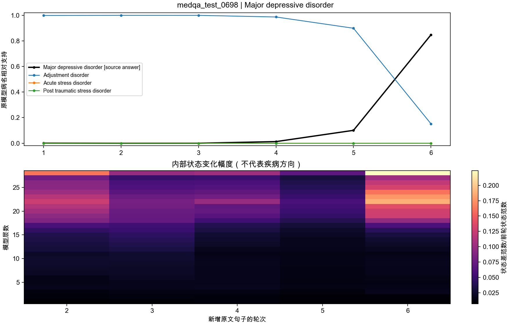

# medqa_test_0698：Major depressive disorder

来源：MedQA四选项test，第698行（零起始）。来源答案只用于完整题目评价。路径：转向来源病后保持。下图没有用DDxPlus探针解码MedQA病名。

Which of the following is the most likely diagnosis?

| 轮 | 原模型首选 | 来源答案支持 | 本轮新增原文 |
|---|---|---:|---|
| 1 | Adjustment disorder | 0.0009 | A 34-year-old man comes to the physician with a 2-month history of difficulty concentrating at work. |
| 2 | Adjustment disorder | 0.0000 | He is worried he may lose his job due to poor performance. |
| 3 | Adjustment disorder | 0.0002 | He feels constantly tired but attributes his fatigue to waking up early most mornings and being unable to fall back asleep. |
| 4 | Adjustment disorder | 0.0128 | His wife has noticed that he has been speaking more slowly than usual and his appetite has decreased. |
| 5 | Adjustment disorder | 0.1009 | He used to enjoy dance classes with her but has not been as interested in this recently. |
| 6 | Major depressive disorder | 0.8478 | He is a veteran who returned from a deployment to Afghanistan 2 years ago. |

| 完整题目控制 | 原模型首选 | 来源答案支持改变 |
|---|---|---:|
| reverse | Adjustment disorder | -0.8476 |
| shuffle | Adjustment disorder | -0.8470 |
| wrong_history | Adjustment disorder | -0.8478 |

原题选项：{"A": "Major depressive disorder", "B": "Adjustment disorder", "C": "Acute stress disorder", "D": "Post traumatic stress disorder"}
