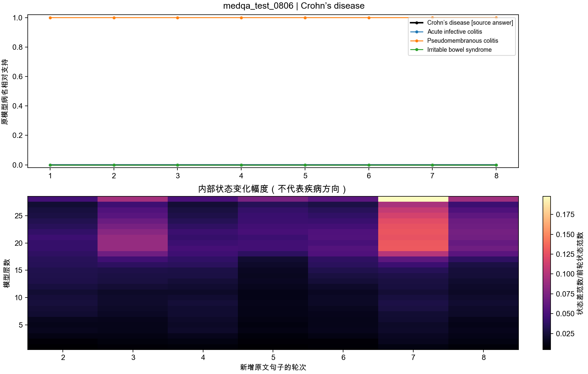

# medqa_test_0806：Crohn’s disease

来源：MedQA四选项test，第806行（零起始）。来源答案只用于完整题目评价。路径：始终固定另一病。下图没有用DDxPlus探针解码MedQA病名。

What is the most likely diagnosis?

| 轮 | 原模型首选 | 来源答案支持 | 本轮新增原文 |
|---|---|---:|---|
| 1 | Pseudomembranous colitis | 0.0000 | A 30-year-old woman presents to the physician because of ongoing diarrhea for the past 1 month. |
| 2 | Pseudomembranous colitis | 0.0000 | She reports that diarrhea has been intermittently present for the past month. |
| 3 | Pseudomembranous colitis | 0.0000 | The stool is often loose and associated with blood and lower abdominal pain. |
| 4 | Pseudomembranous colitis | 0.0000 | She denies any recent travel history, and she works at a nursing home as a caretaker. |
| 5 | Pseudomembranous colitis | 0.0000 | She is not currently on any medications. |
| 6 | Pseudomembranous colitis | 0.0000 | Clinical examination shows mild tenderness in the suprapubic region, and there is no organomegaly. |
| 7 | Pseudomembranous colitis | 0.0000 | Findings on colonoscopy include patchy erythema and ulceration in the cecum, ascending, descending, and sigmoid colon. |
| 8 | Pseudomembranous colitis | 0.0000 | Mucosal biopsy shows colonic crypts with lymphocytic and neutrophilic infiltrates. |

| 完整题目控制 | 原模型首选 | 来源答案支持改变 |
|---|---|---:|
| reverse | Pseudomembranous colitis | +0.0000 |
| shuffle | Pseudomembranous colitis | +0.0000 |
| wrong_history | Pseudomembranous colitis | -0.0000 |

原题选项：{"A": "Crohn’s disease", "B": "Acute infective colitis", "C": "Pseudomembranous colitis", "D": "Irritable bowel syndrome"}
