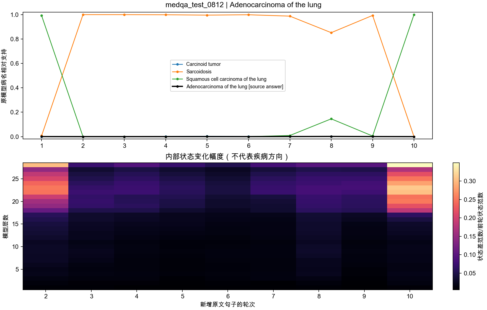

# medqa_test_0812：Adenocarcinoma of the lung

来源：MedQA四选项test，第812行（零起始）。来源答案只用于完整题目评价。路径：在其他疾病间变动。下图没有用DDxPlus探针解码MedQA病名。

Which of the following is the most likely diagnosis?

| 轮 | 原模型首选 | 来源答案支持 | 本轮新增原文 |
|---|---|---:|---|
| 1 | Squamous cell carcinoma of the lung | 0.0003 | A 45-year-old African-American woman comes to the physician after an episode of hemoptysis. |
| 2 | Sarcoidosis | 0.0000 | Over the past 8 months, she has had a nonproductive cough, fatigue, and a 9-kg (20-lb) weight loss. |
| 3 | Sarcoidosis | 0.0000 | She drinks a glass of wine every night and does not smoke. |
| 4 | Sarcoidosis | 0.0003 | She has a history of hypertension and osteoarthritis. |
| 5 | Sarcoidosis | 0.0004 | She does not take any medications. |
| 6 | Sarcoidosis | 0.0001 | She has never traveled out of the country. |
| 7 | Sarcoidosis | 0.0007 | She works as an accountant. |
| 8 | Sarcoidosis | 0.0015 | Her temperature is 37.0°C (98.6°F), pulse is 94/min, and blood pressure is 130/90 mm Hg. |
| 9 | Sarcoidosis | 0.0005 | Lungs are clear to auscultation. |
| 10 | Squamous cell carcinoma of the lung | 0.0000 | An x-ray of the chest shows a 2.5-cm nodule with irregular borders at the apex of the left lung with no mediastinal or hilar enlargement. |

| 完整题目控制 | 原模型首选 | 来源答案支持改变 |
|---|---|---:|
| reverse | Squamous cell carcinoma of the lung | +0.0000 |
| shuffle | Squamous cell carcinoma of the lung | +0.0000 |
| wrong_history | Sarcoidosis | -0.0000 |

原题选项：{"A": "Carcinoid tumor", "B": "Sarcoidosis", "C": "Squamous cell carcinoma of the lung", "D": "Adenocarcinoma of the lung"}
