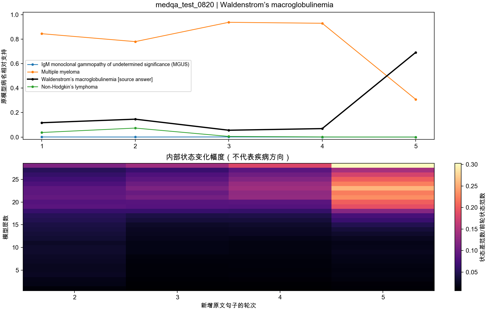

# medqa_test_0820：Waldenstrom’s macroglobulinemia

来源：MedQA四选项test，第820行（零起始）。来源答案只用于完整题目评价。路径：转向来源病后保持。下图没有用DDxPlus探针解码MedQA病名。

What is the most likely diagnosis in this case?

| 轮 | 原模型首选 | 来源答案支持 | 本轮新增原文 |
|---|---|---:|---|
| 1 | Multiple myeloma | 0.1172 | A 68-year-old man presents with a 6-month history of worsening fatigue and weight loss. |
| 2 | Multiple myeloma | 0.1462 | He is especially concerned about a recent episode in which he noticed a blurring of his vision and headache; he also notes that his “memory is not as good as it used to be,” which his wife confirms. |
| 3 | Multiple myeloma | 0.0559 | Physical exam is notable only for pallor and general weakness. |
| 4 | Multiple myeloma | 0.0692 | Laboratory studies reveal anemia as well as an elevated erythrocyte sedimentation rate. |
| 5 | Waldenstrom’s macroglobulinemia | 0.6916 | Serum protein electrophoresis (SPEP) reveals a sharp, narrow spike of monoclonal IgM; serum IgM concentration is 6.3 g/dL. |

| 完整题目控制 | 原模型首选 | 来源答案支持改变 |
|---|---|---:|
| reverse | Multiple myeloma | -0.6888 |
| shuffle | Waldenstrom’s macroglobulinemia | -0.1154 |
| wrong_history | Multiple myeloma | -0.6484 |

原题选项：{"A": "IgM monoclonal gammopathy of undetermined significance (MGUS)", "B": "Multiple myeloma", "C": "Waldenstrom’s macroglobulinemia", "D": "Non-Hodgkin’s lymphoma"}
