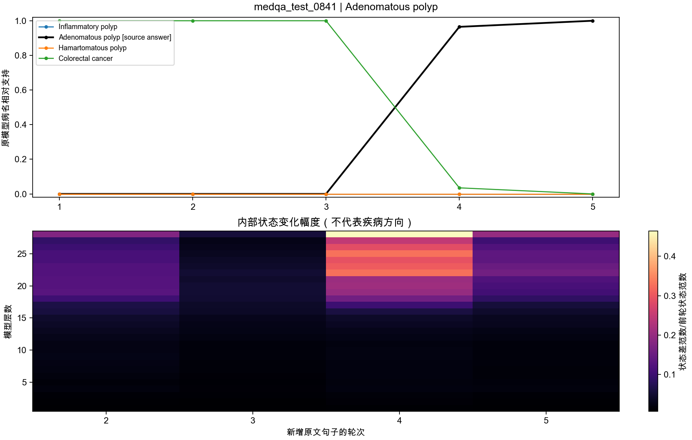

# medqa_test_0841：Adenomatous polyp

来源：MedQA四选项test，第841行（零起始）。来源答案只用于完整题目评价。路径：转向来源病后保持。下图没有用DDxPlus探针解码MedQA病名。

Which of the following is the most likely diagnosis?

| 轮 | 原模型首选 | 来源答案支持 | 本轮新增原文 |
|---|---|---:|---|
| 1 | Colorectal cancer | 0.0000 | On routine screening, a 62-year-old man is found to have positive fecal occult blood tests. |
| 2 | Colorectal cancer | 0.0000 | He is asymptomatic, but his father died of large intestinal cancer. |
| 3 | Colorectal cancer | 0.0000 | Abdominal and rectal exams are normal. |
| 4 | Adenomatous polyp | 0.9649 | A colonoscopy subsequently reveals a polyp in the descending colon but no other abnormalities. |
| 5 | Adenomatous polyp | 1.0000 | Excisional biopsy of the polyp shows 75% tubular architecture. |

| 完整题目控制 | 原模型首选 | 来源答案支持改变 |
|---|---|---:|
| reverse | Adenomatous polyp | -0.0032 |
| shuffle | Adenomatous polyp | +0.0000 |
| wrong_history | Colorectal cancer | -1.0000 |

原题选项：{"A": "Inflammatory polyp", "B": "Adenomatous polyp", "C": "Hamartomatous polyp", "D": "Colorectal cancer"}
