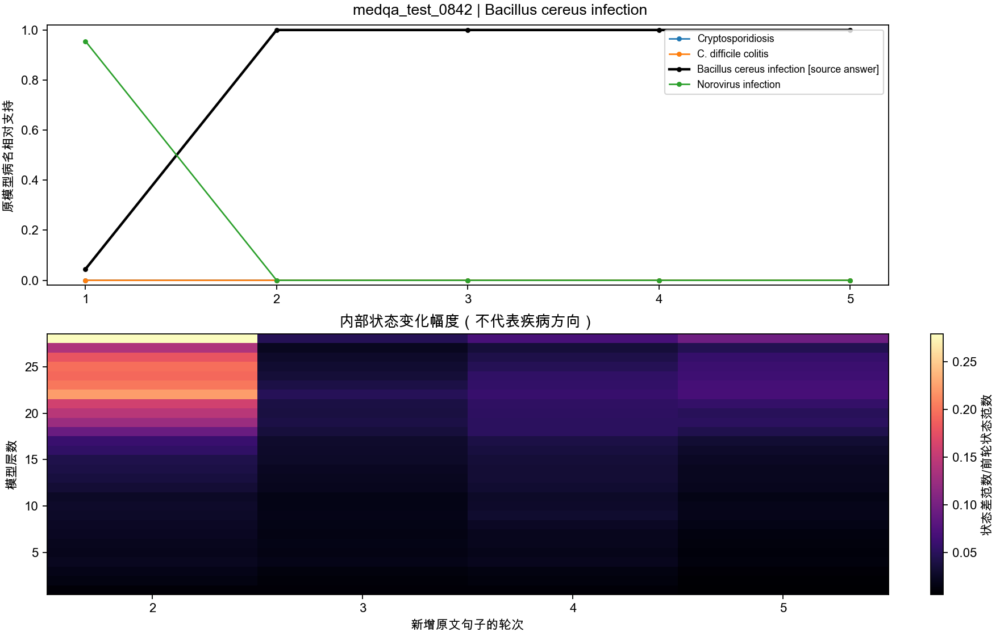

# medqa_test_0842：Bacillus cereus infection

来源：MedQA四选项test，第842行（零起始）。来源答案只用于完整题目评价。路径：转向来源病后保持。下图没有用DDxPlus探针解码MedQA病名。

What is the most likely diagnosis?

| 轮 | 原模型首选 | 来源答案支持 | 本轮新增原文 |
|---|---|---:|---|
| 1 | Norovirus infection | 0.0447 | A 20-year-old male college student presents to the emergency room at 4 AM in the morning with complaints of abdominal cramps, nausea, vomiting, and diarrhea for the past 2 hours. |
| 2 | Bacillus cereus infection | 1.0000 | He was studying for his exams last night when he became hungry and ate some food from the afternoon after heating it for a while. |
| 3 | Bacillus cereus infection | 1.0000 | He says that his symptoms began an hour after he ate the food. |
| 4 | Bacillus cereus infection | 1.0000 | His temperature is 37°C (98.6°F), respiratory rate is 15/min, pulse is 106/min, and blood pressure is 90/78 mm Hg. |
| 5 | Bacillus cereus infection | 0.9999 | A physical examination is within normal limits except for signs of dehydration. |

| 完整题目控制 | 原模型首选 | 来源答案支持改变 |
|---|---|---:|
| reverse | Bacillus cereus infection | +0.0001 |
| shuffle | Bacillus cereus infection | +0.0001 |
| wrong_history | Bacillus cereus infection | +0.0001 |

原题选项：{"A": "Cryptosporidiosis", "B": "C. difficile colitis", "C": "Bacillus cereus infection", "D": "Norovirus infection"}
