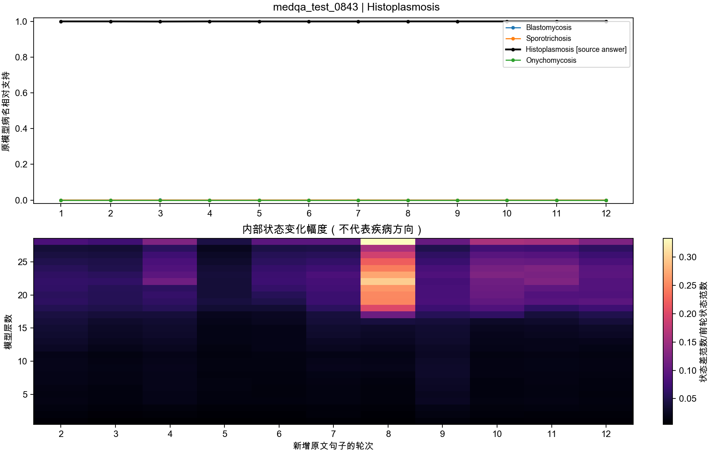

# medqa_test_0843：Histoplasmosis

来源：MedQA四选项test，第843行（零起始）。来源答案只用于完整题目评价。路径：始终首选来源病。下图没有用DDxPlus探针解码MedQA病名。

Which of the following is the most likely diagnosis?

| 轮 | 原模型首选 | 来源答案支持 | 本轮新增原文 |
|---|---|---:|---|
| 1 | Histoplasmosis | 1.0000 | A 79-year-old woman presents to her physician complaining of a persistent non-productive cough and dyspnea after contracting a cold in the past month. |
| 2 | Histoplasmosis | 0.9999 | She describes herself as being “generally healthy” before the cold started. |
| 3 | Histoplasmosis | 0.9993 | Medical history includes hypertension and hyperlipidemia. |
| 4 | Histoplasmosis | 1.0000 | The patient takes hydrochlorothiazide, lisinopril, and atorvastatin. |
| 5 | Histoplasmosis | 0.9999 | Her parents are both deceased. |
| 6 | Histoplasmosis | 0.9997 | She does not smoke and only drinks alcohol occasionally. |
| 7 | Histoplasmosis | 0.9998 | During a review of symptoms, she described a month-long trip to St. |
| 8 | Histoplasmosis | 1.0000 | Louis, Missouri, to visit family. |
| 9 | Histoplasmosis | 1.0000 | At the physician’s office, her temperature is 37.0°C (98.6°F), pulse is 82/min, respirations are 20/min, and blood pressure is 130/82 mm Hg. |
| 10 | Histoplasmosis | 1.0000 | A focused chest exam reveals mild crepitus on the right side. |
| 11 | Histoplasmosis | 1.0000 | A chest X-ray shows a cavitary lesion in the right lung which is confirmed on chest computed tomography (CT). |
| 12 | Histoplasmosis | 1.0000 | A lung biopsy is performed to rule out cancer and reveals necrotic granulomatous inflammation with oval yeast in macrophages. |

| 完整题目控制 | 原模型首选 | 来源答案支持改变 |
|---|---|---:|
| reverse | Blastomycosis | -0.8267 |
| shuffle | Histoplasmosis | -0.0145 |
| wrong_history | Histoplasmosis | -0.0004 |

原题选项：{"A": "Blastomycosis", "B": "Sporotrichosis", "C": "Histoplasmosis", "D": "Onychomycosis"}
