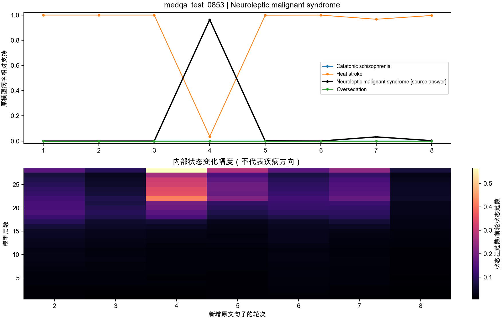

# medqa_test_0853：Neuroleptic malignant syndrome

来源：MedQA四选项test，第853行（零起始）。来源答案只用于完整题目评价。路径：曾选来源病，最后离开。下图没有用DDxPlus探针解码MedQA病名。

Which of the following is the most likely diagnosis?

| 轮 | 原模型首选 | 来源答案支持 | 本轮新增原文 |
|---|---|---:|---|
| 1 | Heat stroke | 0.0000 | A 22-year-old man is brought to the emergency department by police after he was found undressing himself outside in 110°F weather. |
| 2 | Heat stroke | 0.0000 | The patient refuses to answer any questions as he suspects that his care team is spying on him. |
| 3 | Heat stroke | 0.0000 | The patient recently started college and has presented to the emergency department once before for polysubstance intoxication. |
| 4 | Neuroleptic malignant syndrome | 0.9638 | The patient attempts to assault a nurse, is restrained, and given diphenhydramine and haloperidol. |
| 5 | Heat stroke | 0.0008 | When the patient is able to be examined, he is somnolent and non-responsive. |
| 6 | Heat stroke | 0.0000 | His temperature is 104°F (40°C), blood pressure is 147/98 mmHg, pulse is 120/min, respirations are 17/min, and oxygen saturation is 98% on room air. |
| 7 | Heat stroke | 0.0331 | He does not comply with any commands, and it is not possible to freely manipulate his extremities due to rigidity. |
| 8 | Heat stroke | 0.0031 | His mucous membranes are dry. |

| 完整题目控制 | 原模型首选 | 来源答案支持改变 |
|---|---|---:|
| reverse | Neuroleptic malignant syndrome | +0.6340 |
| shuffle | Neuroleptic malignant syndrome | +0.9820 |
| wrong_history | Heat stroke | -0.0031 |

原题选项：{"A": "Catatonic schizophrenia", "B": "Heat stroke", "C": "Neuroleptic malignant syndrome", "D": "Oversedation"}
