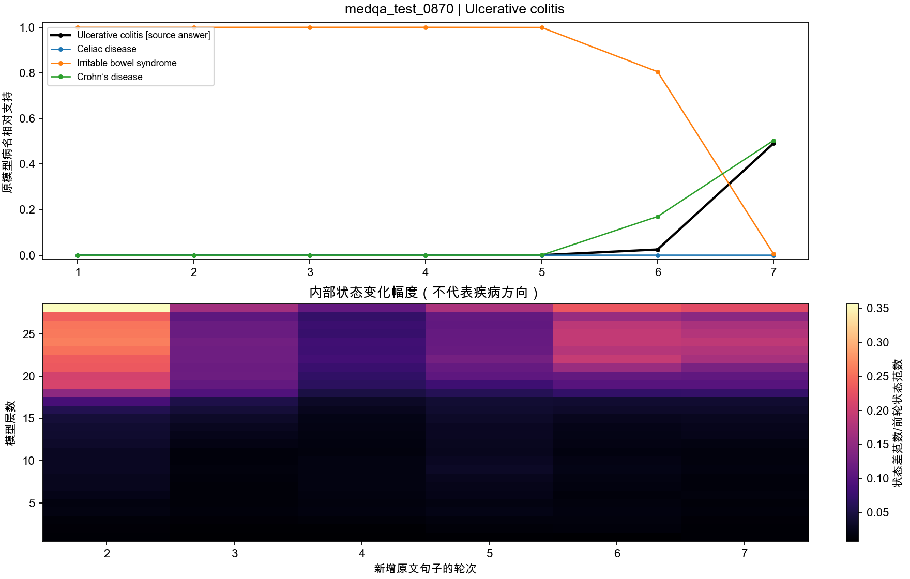

# medqa_test_0870：Ulcerative colitis

来源：MedQA四选项test，第870行（零起始）。来源答案只用于完整题目评价。路径：在其他疾病间变动。下图没有用DDxPlus探针解码MedQA病名。

What is the most likely diagnosis?

| 轮 | 原模型首选 | 来源答案支持 | 本轮新增原文 |
|---|---|---:|---|
| 1 | Irritable bowel syndrome | 0.0000 | A 41-year-old man presents to the clinic with the complaints of abdominal discomfort and cramping for the past 4 months. |
| 2 | Irritable bowel syndrome | 0.0001 | He also mentions that he has grossly bloody stool and most of the time an urge to defecate. |
| 3 | Irritable bowel syndrome | 0.0000 | He has a history of bulimia with laxative abuse several years ago. |
| 4 | Irritable bowel syndrome | 0.0000 | He admits having lost about 5 lb in the past month. |
| 5 | Irritable bowel syndrome | 0.0002 | His temperature is 37° C (98.6° F), respiratory rate is 15/min, pulse is 77/min, and blood pressure is 105/86 mm Hg. |
| 6 | Irritable bowel syndrome | 0.0251 | On physical examination, a mild conjunctival pallor is evident, and the rectum is erythematous, indurated, and tender. |
| 7 | Crohn’s disease | 0.4908 | Colonoscopy demonstrates continuous mucosal lesions throughout the rectum to the hepatic flexure of the colon. |

| 完整题目控制 | 原模型首选 | 来源答案支持改变 |
|---|---|---:|
| reverse | Irritable bowel syndrome | -0.4514 |
| shuffle | Crohn’s disease | -0.2290 |
| wrong_history | Irritable bowel syndrome | -0.4685 |

原题选项：{"A": "Ulcerative colitis", "B": "Celiac disease", "C": "Irritable bowel syndrome", "D": "Crohn’s disease"}
