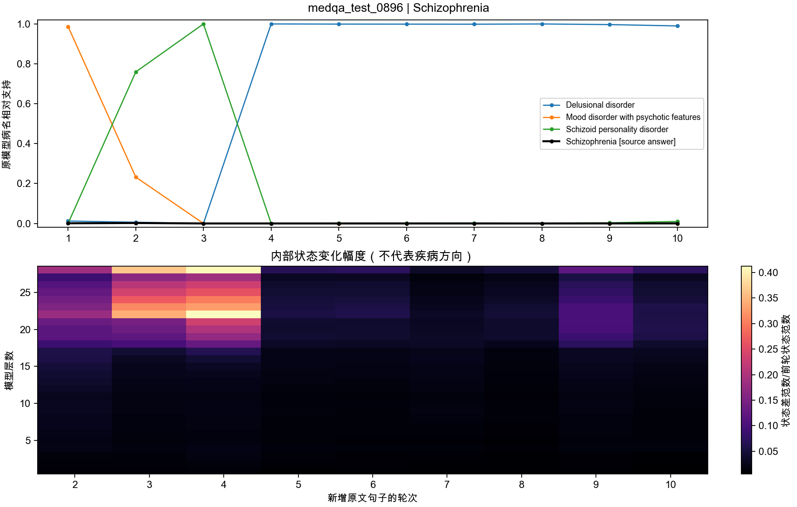

# medqa_test_0896：Schizophrenia

来源：MedQA四选项test，第896行（零起始）。来源答案只用于完整题目评价。路径：在其他疾病间变动。下图没有用DDxPlus探针解码MedQA病名。

Which of the following is the most likely diagnosis?

| 轮 | 原模型首选 | 来源答案支持 | 本轮新增原文 |
|---|---|---:|---|
| 1 | Mood disorder with psychotic features | 0.0009 | A 23-year-old man is brought to the emergency department by his mother because of a change in his personality. |
| 2 | Schizoid personality disorder | 0.0022 | The mother reports that over the past 7 months her son has become increasingly withdrawn; he has not answered any phone calls or visited his family and friends. |
| 3 | Schizoid personality disorder | 0.0000 | He had always been a quiet boy, who needed some time on his own, but he used to meet with friends at least once a week. |
| 4 | Delusional disorder | 0.0000 | The patient says that he cannot leave the house because aliens are watching him and “stealing his thoughts”. |
| 5 | Delusional disorder | 0.0000 | He does not drink alcohol. |
| 6 | Delusional disorder | 0.0000 | He used to smoke marijuana occasionally but quit 1 year ago. |
| 7 | Delusional disorder | 0.0000 | His vital signs are within normal limits. |
| 8 | Delusional disorder | 0.0000 | Physical examination shows no abnormalities. |
| 9 | Delusional disorder | 0.0002 | On mental status examination, it is impossible to follow the patient's sequence of thoughts. |
| 10 | Delusional disorder | 0.0003 | He is anxious and has a flat affect. |

| 完整题目控制 | 原模型首选 | 来源答案支持改变 |
|---|---|---:|
| reverse | Delusional disorder | +0.0049 |
| shuffle | Delusional disorder | -0.0003 |
| wrong_history | Delusional disorder | -0.0003 |

原题选项：{"A": "Delusional disorder", "B": "Mood disorder with psychotic features", "C": "Schizoid personality disorder", "D": "Schizophrenia"}
