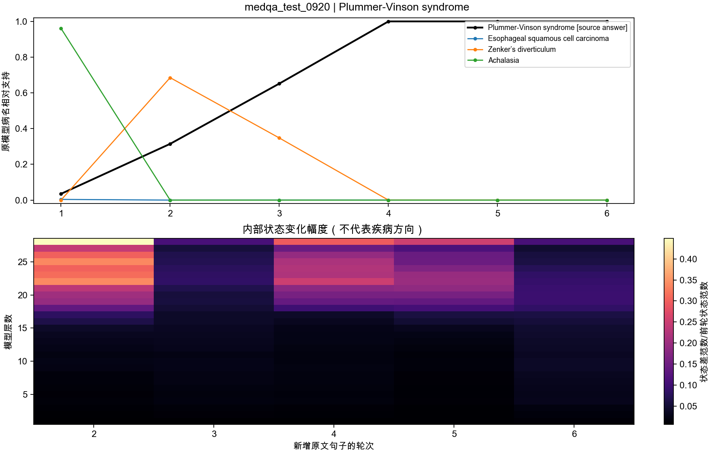

# medqa_test_0920：Plummer-Vinson syndrome

来源：MedQA四选项test，第920行（零起始）。来源答案只用于完整题目评价。路径：转向来源病后保持。下图没有用DDxPlus探针解码MedQA病名。

What is the most likely diagnosis?

| 轮 | 原模型首选 | 来源答案支持 | 本轮新增原文 |
|---|---|---:|---|
| 1 | Achalasia | 0.0350 | A 61-year-old woman presents to an outpatient clinic with fatigue and mild neck pain for a month. |
| 2 | Zenker’s diverticulum | 0.3147 | She adds that she is having difficulty swallowing. |
| 3 | Plummer-Vinson syndrome | 0.6519 | She denies trouble with her breathing but endorses 5–10 lb of unintentional weight loss over the past few months. |
| 4 | Plummer-Vinson syndrome | 1.0000 | On physical exam, the patient’s fingernails appear flat and mild conjunctival pallor is noted. |
| 5 | Plummer-Vinson syndrome | 1.0000 | An upper barium esophagram shows an upper esophageal web. |
| 6 | Plummer-Vinson syndrome | 1.0000 | A complete blood count reveals:
Hb% 10 gm/dL
Total count (WBC) 11,000 /mm3
Differential count:
Neutrophile 70%
Lymphocytes 25%
Monocytes 5%
ESR 10 mm/hr |

| 完整题目控制 | 原模型首选 | 来源答案支持改变 |
|---|---|---:|
| reverse | Plummer-Vinson syndrome | -0.0000 |
| shuffle | Plummer-Vinson syndrome | -0.0000 |
| wrong_history | Esophageal squamous cell carcinoma | -1.0000 |

原题选项：{"A": "Plummer-Vinson syndrome", "B": "Esophageal squamous cell carcinoma", "C": "Zenker’s diverticulum", "D": "Achalasia"}
