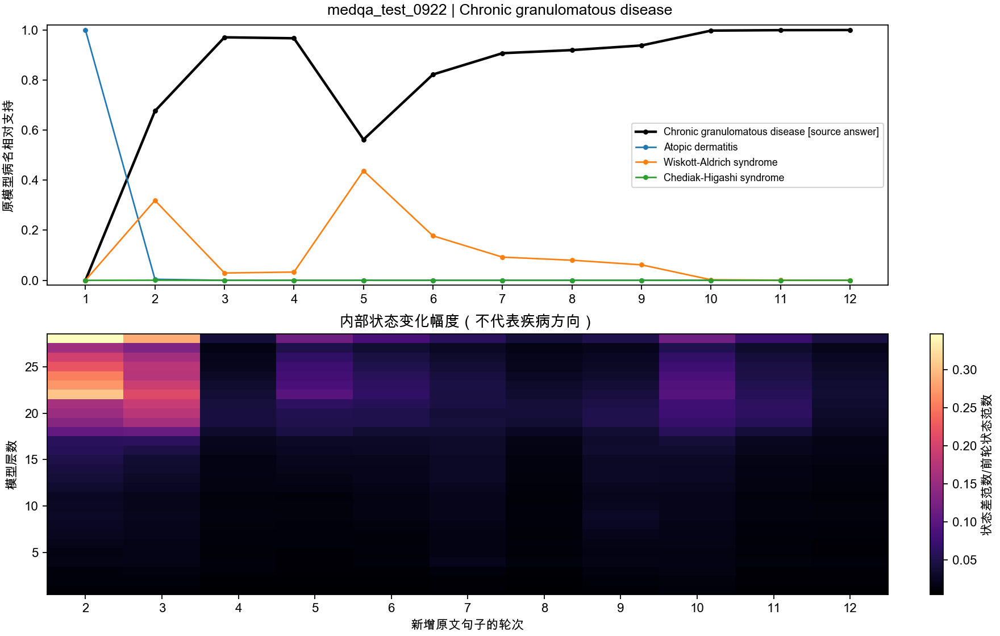

# medqa_test_0922：Chronic granulomatous disease

来源：MedQA四选项test，第922行（零起始）。来源答案只用于完整题目评价。路径：转向来源病后保持。下图没有用DDxPlus探针解码MedQA病名。

Which of the following is the most likely diagnosis?

| 轮 | 原模型首选 | 来源答案支持 | 本轮新增原文 |
|---|---|---:|---|
| 1 | Atopic dermatitis | 0.0000 | A 3-year-old boy is brought to the physician for the evaluation of recurrent skin lesions. |
| 2 | Chronic granulomatous disease | 0.6764 | The episodes of lesions started at the age of 2 months and multiple treatment options have been attempted without success. |
| 3 | Chronic granulomatous disease | 0.9708 | He has also had several episodes of respiratory tract infections, enlarged lymph nodes, and recurrent fevers since birth. |
| 4 | Chronic granulomatous disease | 0.9670 | The boy attends daycare. |
| 5 | Chronic granulomatous disease | 0.5624 | His older brother has asthma. |
| 6 | Chronic granulomatous disease | 0.8223 | The patient's immunizations are up-to-date. |
| 7 | Chronic granulomatous disease | 0.9074 | He is at the 5th percentile for length and 10th percentile for weight. |
| 8 | Chronic granulomatous disease | 0.9197 | He appears ill. |
| 9 | Chronic granulomatous disease | 0.9382 | His temperature is 38°C (100.4°F), pulse is 100/min, and blood pressure is 100/60 mm Hg. |
| 10 | Chronic granulomatous disease | 0.9976 | Examination shows several raised, erythematous lesions of different sizes over the face, neck, groins, and extremities; some secrete pus. |
| 11 | Chronic granulomatous disease | 0.9994 | Cervical and axillary lymph nodes are enlarged bilaterally. |
| 12 | Chronic granulomatous disease | 0.9999 | The remainder of the examination shows no abnormalities. |

| 完整题目控制 | 原模型首选 | 来源答案支持改变 |
|---|---|---:|
| reverse | Chronic granulomatous disease | -0.0149 |
| shuffle | Chronic granulomatous disease | -0.0044 |
| wrong_history | Atopic dermatitis | -0.8396 |

原题选项：{"A": "Chronic granulomatous disease", "B": "Atopic dermatitis", "C": "Wiskott-Aldrich syndrome", "D": "Chediak-Higashi syndrome"}
