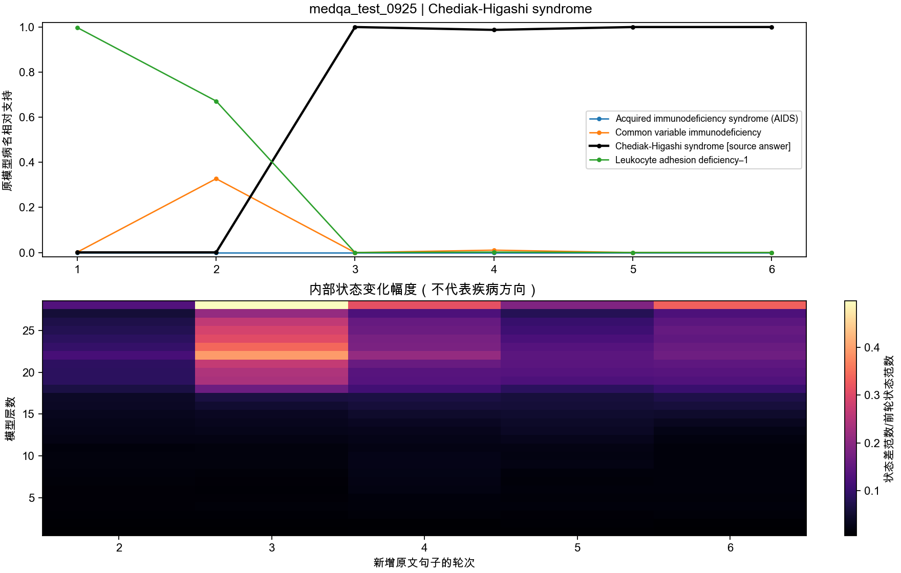

# medqa_test_0925：Chediak-Higashi syndrome

来源：MedQA四选项test，第925行（零起始）。来源答案只用于完整题目评价。路径：转向来源病后保持。下图没有用DDxPlus探针解码MedQA病名。

Which of the following is the most likely diagnosis in this patient?

| 轮 | 原模型首选 | 来源答案支持 | 本轮新增原文 |
|---|---|---:|---|
| 1 | Leukocyte adhesion deficiency–1 | 0.0007 | A 6-month-old boy presents to a pediatrician for the evaluation of recurrent bacterial infections. |
| 2 | Leukocyte adhesion deficiency–1 | 0.0008 | He has a history of a variety of bacterial infections since birth. |
| 3 | Chediak-Higashi syndrome | 1.0000 | Physical examination reveals light-colored skin with silver-colored hair. |
| 4 | Chediak-Higashi syndrome | 0.9873 | The pediatrician suspects an immunodeficiency disorder and decides to order several tests. |
| 5 | Chediak-Higashi syndrome | 0.9999 | Study of the boy’s neutrophils reveals that they contain large cytoplasmic vacuoles. |
| 6 | Chediak-Higashi syndrome | 1.0000 | Genetic studies show a mutation in the LYST gene. |

| 完整题目控制 | 原模型首选 | 来源答案支持改变 |
|---|---|---:|
| reverse | Chediak-Higashi syndrome | -0.0001 |
| shuffle | Chediak-Higashi syndrome | -0.0000 |
| wrong_history | Chediak-Higashi syndrome | -0.0000 |

原题选项：{"A": "Acquired immunodeficiency syndrome (AIDS)", "B": "Common variable immunodeficiency", "C": "Chediak-Higashi syndrome", "D": "Leukocyte adhesion deficiency–1"}
