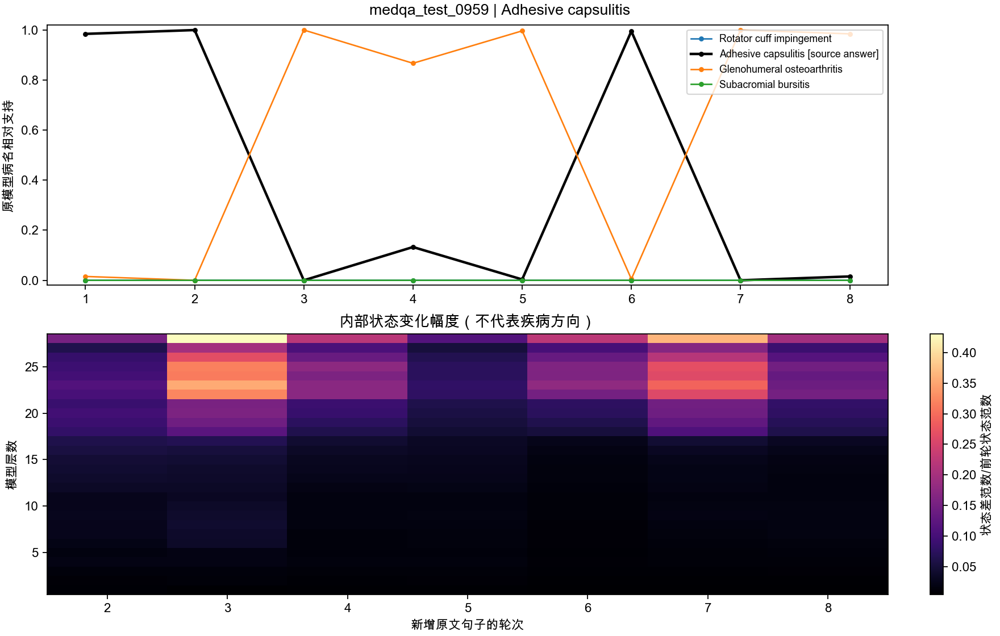

# medqa_test_0959：Adhesive capsulitis

来源：MedQA四选项test，第959行（零起始）。来源答案只用于完整题目评价。路径：曾选来源病，最后离开。下图没有用DDxPlus探针解码MedQA病名。

Which of the following is the most likely diagnosis?

| 轮 | 原模型首选 | 来源答案支持 | 本轮新增原文 |
|---|---|---:|---|
| 1 | Adhesive capsulitis | 0.9845 | A 65-year-old male presents to his primary care physician for stiffness in his arm. |
| 2 | Adhesive capsulitis | 0.9998 | He states that he has been having trouble combing his hair and reaching objects that are high on the shelf. |
| 3 | Glenohumeral osteoarthritis | 0.0000 | The patient has a past medical history of diabetes mellitus type II, obesity, and hypertension. |
| 4 | Glenohumeral osteoarthritis | 0.1330 | His current medications include metformin, insulin, lisinopril, and hydrochlorothiazide. |
| 5 | Glenohumeral osteoarthritis | 0.0035 | The patient admits to leading a sedentary life in which he tends to stay home and watch television. |
| 6 | Adhesive capsulitis | 0.9949 | He does not engage in any physical or strenuous activity. |
| 7 | Glenohumeral osteoarthritis | 0.0000 | On physical exam the patient has decreased passive and active range of motion of his shoulder. |
| 8 | Glenohumeral osteoarthritis | 0.0154 | Strength of the patient's upper extremity is 4/5. |

| 完整题目控制 | 原模型首选 | 来源答案支持改变 |
|---|---|---:|
| reverse | Glenohumeral osteoarthritis | -0.0154 |
| shuffle | Glenohumeral osteoarthritis | -0.0154 |
| wrong_history | Glenohumeral osteoarthritis | +0.0744 |

原题选项：{"A": "Rotator cuff impingement", "B": "Adhesive capsulitis", "C": "Glenohumeral osteoarthritis", "D": "Subacromial bursitis"}
