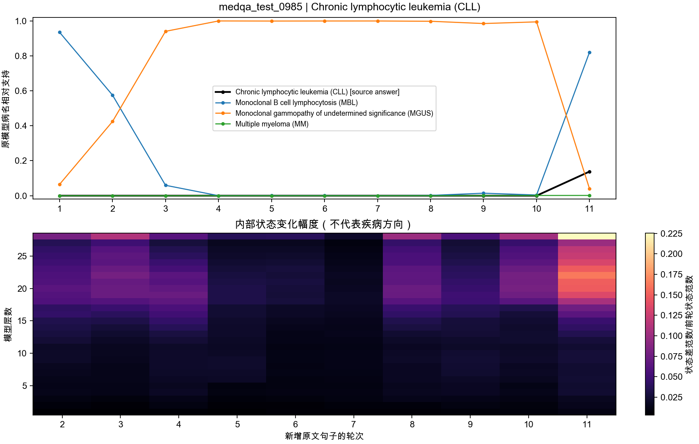

# medqa_test_0985：Chronic lymphocytic leukemia (CLL)

来源：MedQA四选项test，第985行（零起始）。来源答案只用于完整题目评价。路径：在其他疾病间变动。下图没有用DDxPlus探针解码MedQA病名。

Which of the following is the most likely diagnosis?

| 轮 | 原模型首选 | 来源答案支持 | 本轮新增原文 |
|---|---|---:|---|
| 1 | Monoclonal B cell lymphocytosis (MBL) | 0.0000 | A 75-year-old man presents to the physician for his annual blood pressure visit and blood work. |
| 2 | Monoclonal B cell lymphocytosis (MBL) | 0.0000 | He has no complaints other than occasional knee pain. |
| 3 | Monoclonal gammopathy of undetermined significance (MGUS) | 0.0000 | The past medical history includes hypertension. |
| 4 | Monoclonal gammopathy of undetermined significance (MGUS) | 0.0000 | He has had knee osteoarthritis for several years and takes occasional acetaminophen for pain control. |
| 5 | Monoclonal gammopathy of undetermined significance (MGUS) | 0.0000 | His diet is full of vegetables. |
| 6 | Monoclonal gammopathy of undetermined significance (MGUS) | 0.0000 | He exercises every day. |
| 7 | Monoclonal gammopathy of undetermined significance (MGUS) | 0.0000 | He has no history of smoking. |
| 8 | Monoclonal gammopathy of undetermined significance (MGUS) | 0.0000 | He had a brother who died at the age of 84 due to hematologic malignancy. |
| 9 | Monoclonal gammopathy of undetermined significance (MGUS) | 0.0000 | The temperature is 36.8℃ (98.2℉), and the blood pressure is 125/85 mm Hg. |
| 10 | Monoclonal gammopathy of undetermined significance (MGUS) | 0.0000 | The physical examination shows no abnormalities other than a reduced range of motion and crepitus in both knees. |
| 11 | Monoclonal B cell lymphocytosis (MBL) | 0.1381 | The laboratory test results are as follows:
Hemoglobin 15 g/dL
Leukocyte count 58,000/mm3
Platelet count 250,000/mm3
Flow cytometry on the peripheral blood reveals an absolute lymphocyte count of 50,000/mm3. |

| 完整题目控制 | 原模型首选 | 来源答案支持改变 |
|---|---|---:|
| reverse | Monoclonal gammopathy of undetermined significance (MGUS) | -0.1381 |
| shuffle | Monoclonal gammopathy of undetermined significance (MGUS) | -0.1368 |
| wrong_history | Monoclonal gammopathy of undetermined significance (MGUS) | -0.1381 |

原题选项：{"A": "Chronic lymphocytic leukemia (CLL)", "B": "Monoclonal B cell lymphocytosis (MBL)", "C": "Monoclonal gammopathy of undetermined significance (MGUS)", "D": "Multiple myeloma (MM)"}
