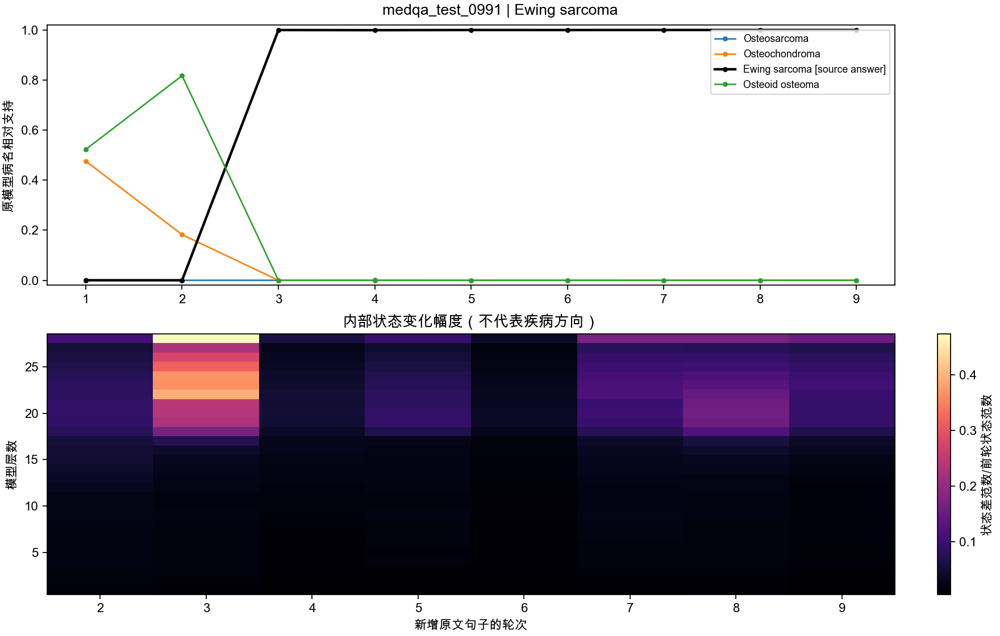

# medqa_test_0991：Ewing sarcoma

来源：MedQA四选项test，第991行（零起始）。来源答案只用于完整题目评价。路径：转向来源病后保持。下图没有用DDxPlus探针解码MedQA病名。

Which of the following is the most likely diagnosis?

| 轮 | 原模型首选 | 来源答案支持 | 本轮新增原文 |
|---|---|---:|---|
| 1 | Osteoid osteoma | 0.0002 | A 13-year-old boy is brought to the physician because of progressive left leg pain for 2 months, which has started to interfere with his sleep. |
| 2 | Osteoid osteoma | 0.0002 | His mother has been giving him ibuprofen at night for “growing pains,” but his symptoms have not improved. |
| 3 | Ewing sarcoma | 0.9998 | One week before the pain started, the patient was hit in the thigh by a baseball, which caused his leg to become red and swollen for several days. |
| 4 | Ewing sarcoma | 0.9993 | Vital signs are within normal limits. |
| 5 | Ewing sarcoma | 0.9999 | Examination shows marked tenderness along the left mid-femur. |
| 6 | Ewing sarcoma | 0.9998 | His gait is normal. |
| 7 | Ewing sarcoma | 1.0000 | Laboratory studies show a leukocyte count of 21,000/mm3 and an ESR of 68 mm/h. |
| 8 | Ewing sarcoma | 1.0000 | An x-ray of the left lower extremity shows multiple lytic lesions in the middle third of the femur, and the surrounding cortex is covered by several layers of new bone. |
| 9 | Ewing sarcoma | 1.0000 | A biopsy of the left femur shows small round blue cells. |

| 完整题目控制 | 原模型首选 | 来源答案支持改变 |
|---|---|---:|
| reverse | Ewing sarcoma | +0.0000 |
| shuffle | Ewing sarcoma | +0.0000 |
| wrong_history | Ewing sarcoma | -0.0061 |

原题选项：{"A": "Osteosarcoma", "B": "Osteochondroma", "C": "Ewing sarcoma", "D": "Osteoid osteoma"}
