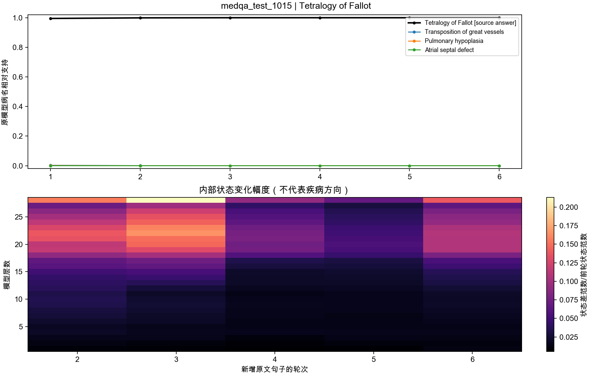

# medqa_test_1015：Tetralogy of Fallot

来源：MedQA四选项test，第1015行（零起始）。来源答案只用于完整题目评价。路径：始终首选来源病。下图没有用DDxPlus探针解码MedQA病名。

Which of the following is the most likely diagnosis?

| 轮 | 原模型首选 | 来源答案支持 | 本轮新增原文 |
|---|---|---:|---|
| 1 | Tetralogy of Fallot | 0.9951 | A 2-year-old girl is brought in to the office by her parents. |
| 2 | Tetralogy of Fallot | 0.9992 | They state that their daughter has recently been more irritable than usual, and she occasionally becomes pale and blue. |
| 3 | Tetralogy of Fallot | 1.0000 | Her parents note that she was diagnosed with a heart murmur, but it was never treated. |
| 4 | Tetralogy of Fallot | 1.0000 | Physical examination reveals a small child in distress. |
| 5 | Tetralogy of Fallot | 1.0000 | She is laying on the examination table with her knees drawn to her chest. |
| 6 | Tetralogy of Fallot | 1.0000 | Cardiac auscultation reveals a harsh, systolic ejection murmur that is best heard at the upper left sternal border. |

| 完整题目控制 | 原模型首选 | 来源答案支持改变 |
|---|---|---:|
| reverse | Tetralogy of Fallot | -0.0159 |
| shuffle | Tetralogy of Fallot | -0.0002 |
| wrong_history | Atrial septal defect | -1.0000 |

原题选项：{"A": "Tetralogy of Fallot", "B": "Transposition of great vessels", "C": "Pulmonary hypoplasia", "D": "Atrial septal defect"}
