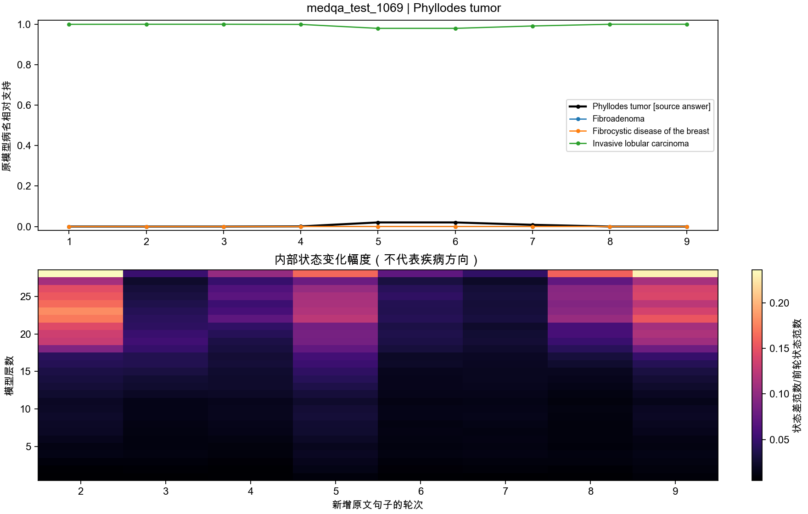

# medqa_test_1069：Phyllodes tumor

来源：MedQA四选项test，第1069行（零起始）。来源答案只用于完整题目评价。路径：始终固定另一病。下图没有用DDxPlus探针解码MedQA病名。

Which of the following is the most likely diagnosis?

| 轮 | 原模型首选 | 来源答案支持 | 本轮新增原文 |
|---|---|---:|---|
| 1 | Invasive lobular carcinoma | 0.0002 | A 45-year-old woman comes to the physician for the evaluation of a right breast mass that she noticed 3 weeks ago. |
| 2 | Invasive lobular carcinoma | 0.0001 | It has rapidly increased in size during this period. |
| 3 | Invasive lobular carcinoma | 0.0001 | She does not have pain. |
| 4 | Invasive lobular carcinoma | 0.0008 | Vital signs are within normal limits. |
| 5 | Invasive lobular carcinoma | 0.0203 | Examination shows large dense breasts; a 5-cm, nontender, multinodular mass is palpated in the right outer quadrant of the right breast. |
| 6 | Invasive lobular carcinoma | 0.0203 | There are no changes in the skin or nipple. |
| 7 | Invasive lobular carcinoma | 0.0086 | There is no palpable cervical or axillary adenopathy. |
| 8 | Invasive lobular carcinoma | 0.0001 | Mammography shows a smooth polylobulated mass. |
| 9 | Invasive lobular carcinoma | 0.0000 | Biopsy of the mass shows papillary projections of epithelial-lined stroma with hyperplasia and atypia. |

| 完整题目控制 | 原模型首选 | 来源答案支持改变 |
|---|---|---:|
| reverse | Invasive lobular carcinoma | +0.1330 |
| shuffle | Invasive lobular carcinoma | +0.0038 |
| wrong_history | Invasive lobular carcinoma | +0.0000 |

原题选项：{"A": "Phyllodes tumor", "B": "Fibroadenoma", "C": "Fibrocystic disease of the breast", "D": "Invasive lobular carcinoma"}
