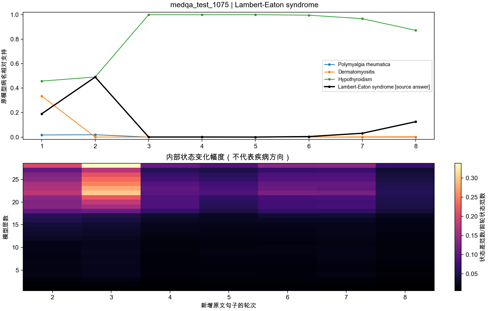

# medqa_test_1075：Lambert-Eaton syndrome

来源：MedQA四选项test，第1075行（零起始）。来源答案只用于完整题目评价。路径：始终固定另一病。下图没有用DDxPlus探针解码MedQA病名。

Which of the following is the most likely diagnosis?

| 轮 | 原模型首选 | 来源答案支持 | 本轮新增原文 |
|---|---|---:|---|
| 1 | Hypothyroidism | 0.1906 | A 53-year-old man comes to the physician because of a 3-month history of cough and progressively worsening difficulty walking up the stairs in his apartment. |
| 2 | Hypothyroidism | 0.4903 | He has noticed that it is easier for him to climb the stairs after he has exercised. |
| 3 | Hypothyroidism | 0.0003 | He has also had a 4.6-kg (10.1-lb) weight loss over the past 6 months. |
| 4 | Hypothyroidism | 0.0005 | He has smoked one pack of cigarettes daily for 35 years. |
| 5 | Hypothyroidism | 0.0000 | Examination shows dry mucous membranes. |
| 6 | Hypothyroidism | 0.0041 | The pupils are equal and react sluggishly to light. |
| 7 | Hypothyroidism | 0.0311 | Muscle strength in the proximal lower extremity is initially 3/5 but increases to 5/5 after repeated muscle tapping. |
| 8 | Hypothyroidism | 0.1256 | His achilles reflex is 1+. |

| 完整题目控制 | 原模型首选 | 来源答案支持改变 |
|---|---|---:|
| reverse | Hypothyroidism | -0.1230 |
| shuffle | Hypothyroidism | -0.1182 |
| wrong_history | Hypothyroidism | -0.1255 |

原题选项：{"A": "Polymyalgia rheumatica", "B": "Dermatomyositis", "C": "Hypothyroidism", "D": "Lambert-Eaton syndrome"}
