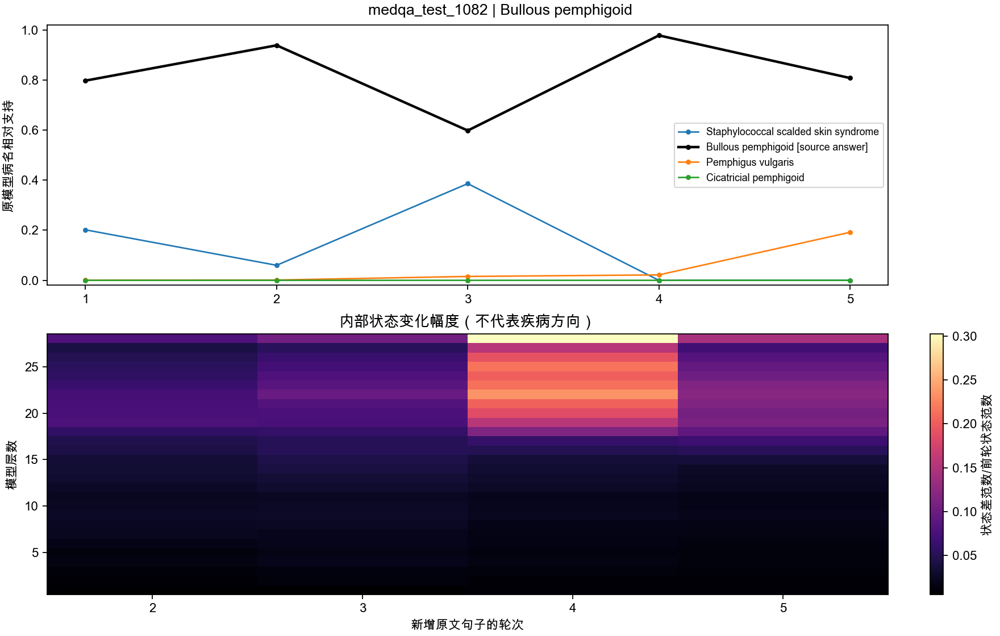

# medqa_test_1082：Bullous pemphigoid

来源：MedQA四选项test，第1082行（零起始）。来源答案只用于完整题目评价。路径：始终首选来源病。下图没有用DDxPlus探针解码MedQA病名。

Which of the following is the most likely diagnosis?

| 轮 | 原模型首选 | 来源答案支持 | 本轮新增原文 |
|---|---|---:|---|
| 1 | Bullous pemphigoid | 0.7977 | An 81-year-old man patient recently moved into an assisted living facility and presents today with itchy blisters in his axilla. |
| 2 | Bullous pemphigoid | 0.9388 | He attributes these to a poor diet. |
| 3 | Bullous pemphigoid | 0.5983 | He also complains that the nurse practitioner at the facility started him on 4 new medications, in addition to his existing prescriptions. |
| 4 | Bullous pemphigoid | 0.9784 | On physical examination, tense axillary bullae are noted that do not rupture with light, gloved touch. |
| 5 | Bullous pemphigoid | 0.8081 | On direct immunofluorescence, linear C3 and IgG deposits are seen along the basement membrane. |

| 完整题目控制 | 原模型首选 | 来源答案支持改变 |
|---|---|---:|
| reverse | Bullous pemphigoid | +0.1905 |
| shuffle | Bullous pemphigoid | +0.1912 |
| wrong_history | Staphylococcal scalded skin syndrome | -0.7620 |

原题选项：{"A": "Staphylococcal scalded skin syndrome", "B": "Bullous pemphigoid", "C": "Pemphigus vulgaris", "D": "Cicatricial pemphigoid"}
