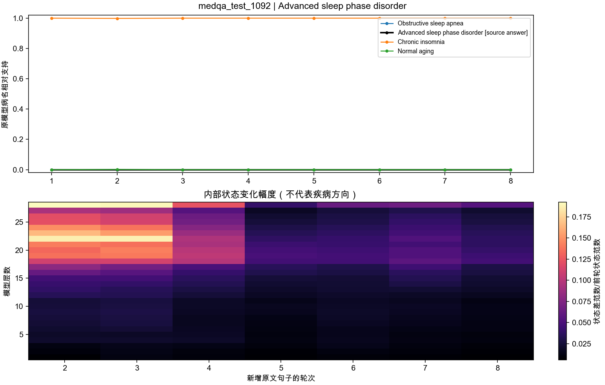

# medqa_test_1092：Advanced sleep phase disorder

来源：MedQA四选项test，第1092行（零起始）。来源答案只用于完整题目评价。路径：始终固定另一病。下图没有用DDxPlus探针解码MedQA病名。

Which of the following is the most likely diagnosis?

| 轮 | 原模型首选 | 来源答案支持 | 本轮新增原文 |
|---|---|---:|---|
| 1 | Chronic insomnia | 0.0000 | A 69-year-old man presents to his primary care physician for trouble sleeping. |
| 2 | Chronic insomnia | 0.0000 | The patient states that he recently retired from working the day shift at a cemetery. |
| 3 | Chronic insomnia | 0.0000 | When the patient retired, his goal was to finally be able to go out with his wife; however, he finds that he is unable to stay awake past 6 pm in the evening. |
| 4 | Chronic insomnia | 0.0000 | His inability to stay awake has been straining his marriage as his wife is disappointed that they cannot do any activities in the evening together. |
| 5 | Chronic insomnia | 0.0000 | The patient has tried drinking caffeine but finds that it does not help. |
| 6 | Chronic insomnia | 0.0000 | The patient’s wife claims that the patient seems to sleep peacefully, and the patient states he feels rested when he awakes. |
| 7 | Chronic insomnia | 0.0000 | The patient has a past medical history of irritable bowel syndrome which is managed with fiber supplements. |
| 8 | Chronic insomnia | 0.0000 | The patient’s neurological exam is within normal limits. |

| 完整题目控制 | 原模型首选 | 来源答案支持改变 |
|---|---|---:|
| reverse | Chronic insomnia | +0.0000 |
| shuffle | Chronic insomnia | +0.0000 |
| wrong_history | Chronic insomnia | -0.0000 |

原题选项：{"A": "Obstructive sleep apnea", "B": "Advanced sleep phase disorder", "C": "Chronic insomnia", "D": "Normal aging"}
