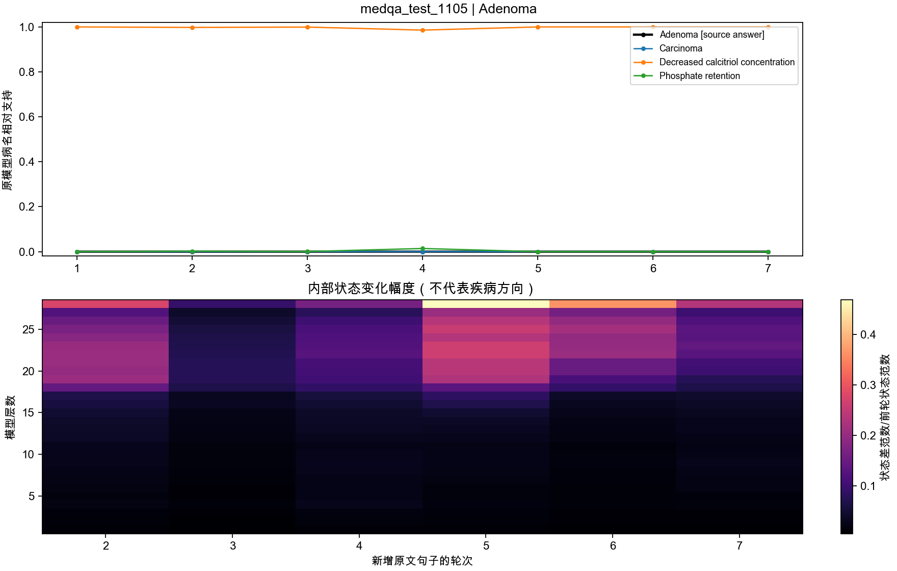

# medqa_test_1105：Adenoma

来源：MedQA四选项test，第1105行（零起始）。来源答案只用于完整题目评价。路径：始终固定另一病。下图没有用DDxPlus探针解码MedQA病名。

Which of the following is the most likely diagnosis in this patient?

| 轮 | 原模型首选 | 来源答案支持 | 本轮新增原文 |
|---|---|---:|---|
| 1 | Decreased calcitriol concentration | 0.0000 | A 55-year-old woman presents to the office because she has been feeling weak. |
| 2 | Decreased calcitriol concentration | 0.0000 | For the past 2 years, she has been urinating a considerable volume every time she goes to the bathroom. |
| 3 | Decreased calcitriol concentration | 0.0000 | She has no past medical history. |
| 4 | Decreased calcitriol concentration | 0.0000 | Her heart rate is 86/min, respiratory rate is 15/min, temperature is 37.4°C (99.3°F), and blood pressure is 111/79 mm Hg. |
| 5 | Decreased calcitriol concentration | 0.0000 | Laboratory studies are significant for the following:
Calcium 13.8 mg/dL
PTH 230 pg/mL
Her complete metabolic panel is otherwise within normal limits. |
| 6 | Decreased calcitriol concentration | 0.0000 | Imaging studies show subperiosteal resorption and osteoporosis. |
| 7 | Decreased calcitriol concentration | 0.0000 | Scintigraphy reveals the most common pathologic condition associated with the patient’s diagnosis. |

| 完整题目控制 | 原模型首选 | 来源答案支持改变 |
|---|---|---:|
| reverse | Decreased calcitriol concentration | -0.0000 |
| shuffle | Decreased calcitriol concentration | +0.0000 |
| wrong_history | Carcinoma | +0.0000 |

原题选项：{"A": "Adenoma", "B": "Carcinoma", "C": "Decreased calcitriol concentration", "D": "Phosphate retention"}
