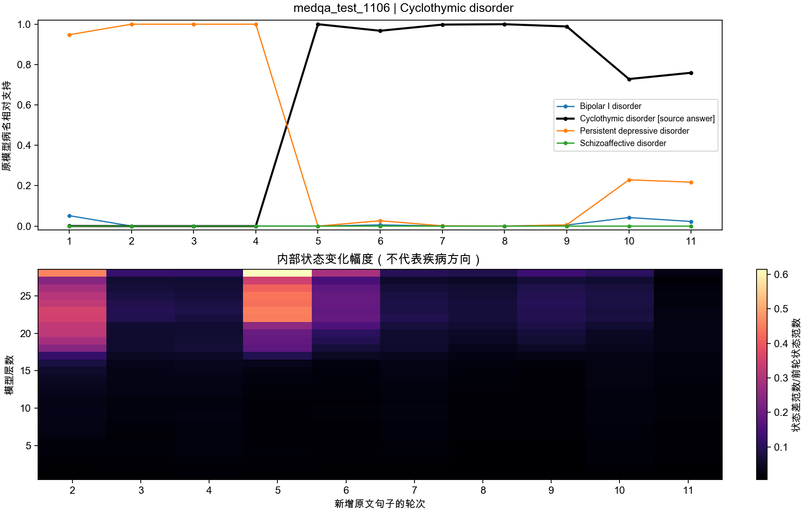

# medqa_test_1106：Cyclothymic disorder

来源：MedQA四选项test，第1106行（零起始）。来源答案只用于完整题目评价。路径：转向来源病后保持。下图没有用DDxPlus探针解码MedQA病名。

Which of the following is the most likely diagnosis in this patient?

| 轮 | 原模型首选 | 来源答案支持 | 本轮新增原文 |
|---|---|---:|---|
| 1 | Persistent depressive disorder | 0.0005 | A 35-year-old woman presents to a psychiatrist for an initial consultation. |
| 2 | Persistent depressive disorder | 0.0000 | She reports that for the past 3 years, she has experienced several periods of depressed mood. |
| 3 | Persistent depressive disorder | 0.0000 | The episodes do not coincide with any specific life events and seem to resolve after 4-6 weeks. |
| 4 | Persistent depressive disorder | 0.0000 | During these episodes, she experiences a depressed mood, sleep disturbances, and a poor appetite, but she at times is able to enjoy spending time with her children and husband but other times she is distressed and cannot enjoy time with them. |
| 5 | Cyclothymic disorder | 1.0000 | Upon further questioning, she also reports experiencing occasional episodes of elevated mood over the past ten years. |
| 6 | Cyclothymic disorder | 0.9675 | During these episodes, she is very productive at her work as a lawyer and requires less sleep than usual. |
| 7 | Cyclothymic disorder | 0.9980 | Her past medical history is notable for obesity, type I diabetes mellitus, and rheumatoid arthritis. |
| 8 | Cyclothymic disorder | 0.9999 | She is on insulin and takes methotrexate. |
| 9 | Cyclothymic disorder | 0.9887 | She smokes marijuana occasionally. |
| 10 | Cyclothymic disorder | 0.7284 | Her temperature is 99.2°F (37.3°C), blood pressure is 124/80 mmHg, pulse is 78/min, and respirations are 17/min. |
| 11 | Cyclothymic disorder | 0.7595 | On exam, she is quiet with a flattened affect, but is cooperative and answers questions thoroughly. |

| 完整题目控制 | 原模型首选 | 来源答案支持改变 |
|---|---|---:|
| reverse | Persistent depressive disorder | -0.7595 |
| shuffle | Persistent depressive disorder | -0.7584 |
| wrong_history | Cyclothymic disorder | +0.1697 |

原题选项：{"A": "Bipolar I disorder", "B": "Cyclothymic disorder", "C": "Persistent depressive disorder", "D": "Schizoaffective disorder"}
