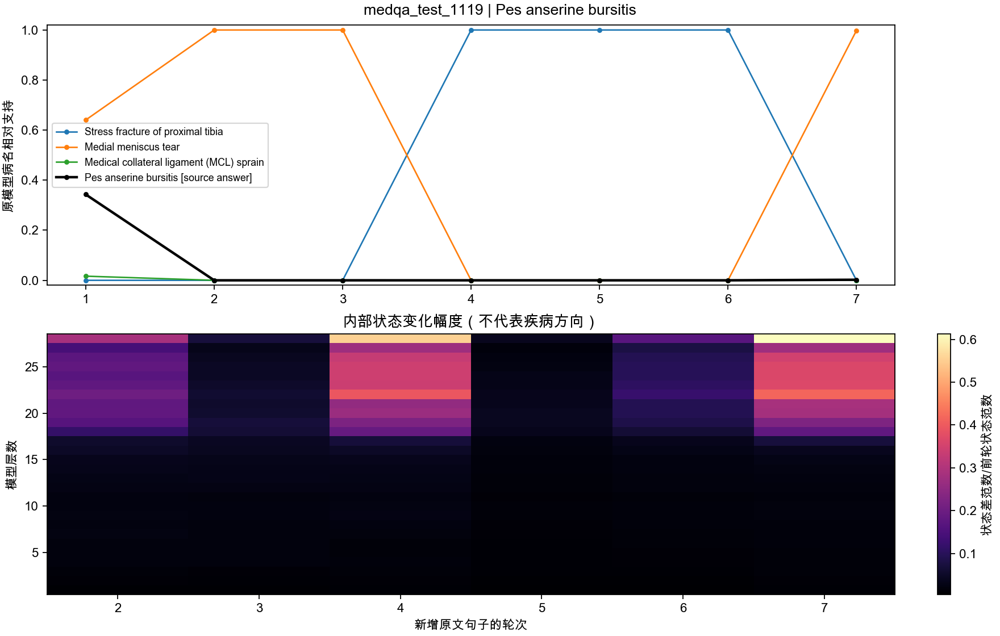

# medqa_test_1119：Pes anserine bursitis

来源：MedQA四选项test，第1119行（零起始）。来源答案只用于完整题目评价。路径：在其他疾病间变动。下图没有用DDxPlus探针解码MedQA病名。

Which of the following is the most likely diagnosis in this patient?

| 轮 | 原模型首选 | 来源答案支持 | 本轮新增原文 |
|---|---|---:|---|
| 1 | Medial meniscus tear | 0.3429 | An obese 42-year-old female presents to her primary care physician with a complaint of left knee pain for the past 3 months. |
| 2 | Medial meniscus tear | 0.0000 | She describes the pain as affecting the inside part of the knee as well as the front of her knee, below the kneecap. |
| 3 | Medial meniscus tear | 0.0000 | She denies any inciting injury or trauma to the knee but reports that the pain is worse when she is climbing up stairs or rising from a chair. |
| 4 | Stress fracture of proximal tibia | 0.0000 | Physical examination is significant for localized tenderness to palpation over the left anteromedial proximal tibia, 6 cm inferior to the joint line. |
| 5 | Stress fracture of proximal tibia | 0.0000 | There is no joint effusion noted. |
| 6 | Stress fracture of proximal tibia | 0.0000 | Valgus stress testing is negative for any pain or instability of the knee joint. |
| 7 | Medial meniscus tear | 0.0023 | Radiographs of the left knee are obtained and reveal only mild arthritis, without evidence of any fractures or bony lesions. |

| 完整题目控制 | 原模型首选 | 来源答案支持改变 |
|---|---|---:|
| reverse | Medial meniscus tear | +0.0087 |
| shuffle | Pes anserine bursitis | +0.5599 |
| wrong_history | Stress fracture of proximal tibia | -0.0023 |

原题选项：{"A": "Stress fracture of proximal tibia", "B": "Medial meniscus tear", "C": "Medical collateral ligament (MCL) sprain", "D": "Pes anserine bursitis"}
