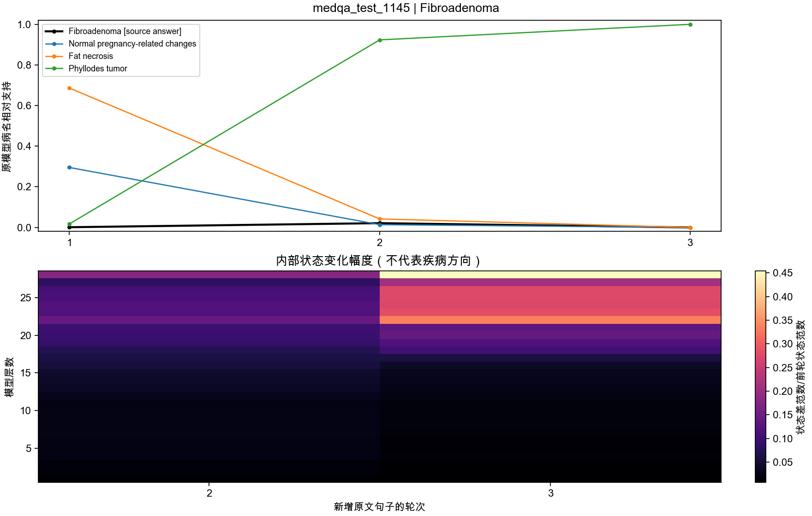

# medqa_test_1145：Fibroadenoma

来源：MedQA四选项test，第1145行（零起始）。来源答案只用于完整题目评价。路径：在其他疾病间变动。下图没有用DDxPlus探针解码MedQA病名。

Which of the following is the most likely diagnosis?

| 轮 | 原模型首选 | 来源答案支持 | 本轮新增原文 |
|---|---|---:|---|
| 1 | Fat necrosis | 0.0010 | A 33-year-old woman at 17-weeks gestation comes to the physician for evaluation of a painless mass in the right breast for the last 3 weeks that has not increased in size. |
| 2 | Phyllodes tumor | 0.0211 | Physical examination shows dense breasts and a 2.5-cm rubbery, mobile mass that is nontender in the upper outer quadrant of the right breast. |
| 3 | Phyllodes tumor | 0.0000 | A biopsy of the mass shows rounded contour with overgrowth of fibrous and glandular tissue. |

| 完整题目控制 | 原模型首选 | 来源答案支持改变 |
|---|---|---:|
| reverse | Phyllodes tumor | +0.0000 |
| shuffle | Phyllodes tumor | +0.0000 |
| wrong_history | Phyllodes tumor | -0.0000 |

原题选项：{"A": "Fibroadenoma", "B": "Normal pregnancy-related changes", "C": "Fat necrosis", "D": "Phyllodes tumor"}
