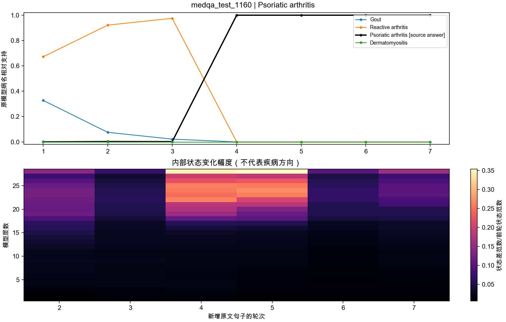

# medqa_test_1160：Psoriatic arthritis

来源：MedQA四选项test，第1160行（零起始）。来源答案只用于完整题目评价。路径：转向来源病后保持。下图没有用DDxPlus探针解码MedQA病名。

Which of the following is the most likely diagnosis?

| 轮 | 原模型首选 | 来源答案支持 | 本轮新增原文 |
|---|---|---:|---|
| 1 | Reactive arthritis | 0.0004 | A 31-year-old female patient presents with significant swelling and redness of her fingers that is causing her significant pain. |
| 2 | Reactive arthritis | 0.0028 | Her right knee has also been stiff and slightly swollen for the past 6 weeks. |
| 3 | Reactive arthritis | 0.0024 | She is overall fatigued and has difficulty moving around but has not sought medical attention until now. |
| 4 | Psoriatic arthritis | 0.9999 | On physical examination, the distal interphalangeal joints are swollen, warm, and painful; her nails are pitted and cracked. |
| 5 | Psoriatic arthritis | 1.0000 | There are also rough, erythematous skin patches seen over her elbows which have been present for the last few months. |
| 6 | Psoriatic arthritis | 1.0000 | She reports that herer father has a similar condition. |
| 7 | Psoriatic arthritis | 1.0000 | They both use hydrating creams and topical glucocorticoids with moderate benefit. |

| 完整题目控制 | 原模型首选 | 来源答案支持改变 |
|---|---|---:|
| reverse | Psoriatic arthritis | -0.0000 |
| shuffle | Psoriatic arthritis | +0.0000 |
| wrong_history | Dermatomyositis | -0.9996 |

原题选项：{"A": "Gout", "B": "Reactive arthritis", "C": "Psoriatic arthritis", "D": "Dermatomyositis"}
