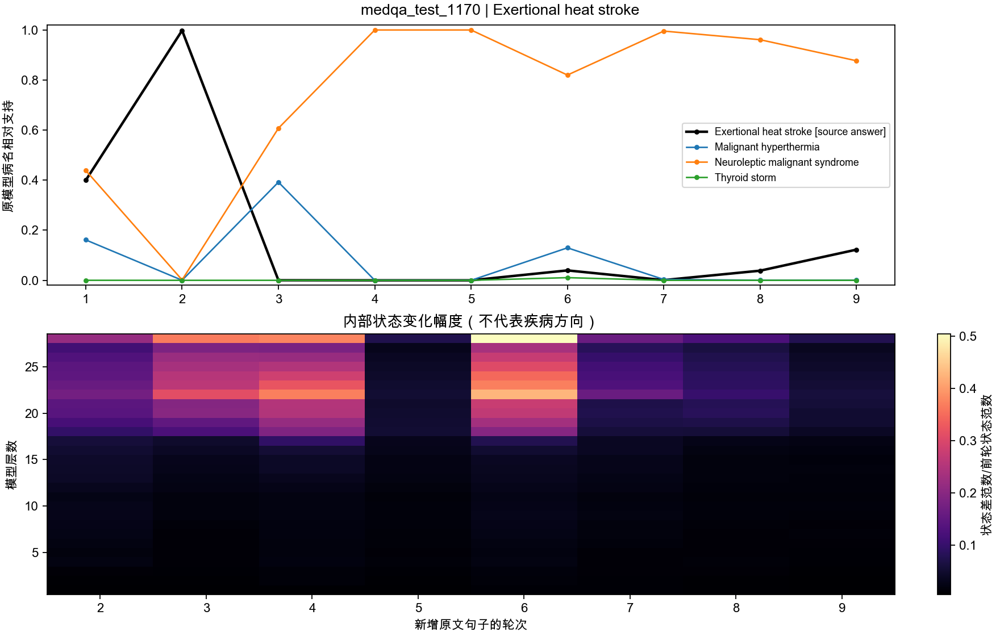

# medqa_test_1170：Exertional heat stroke

来源：MedQA四选项test，第1170行（零起始）。来源答案只用于完整题目评价。路径：曾选来源病，最后离开。下图没有用DDxPlus探针解码MedQA病名。

Which of the following is the most likely diagnosis?

| 轮 | 原模型首选 | 来源答案支持 | 本轮新增原文 |
|---|---|---:|---|
| 1 | Neuroleptic malignant syndrome | 0.3996 | A 33-year-old man presents to the emergency department with altered mental status. |
| 2 | Exertional heat stroke | 0.9981 | He was at work as a construction worker when his coworkers found him down at the work site. |
| 3 | Neuroleptic malignant syndrome | 0.0003 | The patient recently underwent anesthesia for an appendectomy several months ago. |
| 4 | Neuroleptic malignant syndrome | 0.0000 | He also has a past medical history of schizophrenia well controlled with haloperidol and is currently taking phenytoin for epilepsy. |
| 5 | Neuroleptic malignant syndrome | 0.0000 | He is also currently taking propranolol for anxiety and hyperthyroidism. |
| 6 | Neuroleptic malignant syndrome | 0.0396 | His temperature is 106°F (41.1°C), blood pressure is 109/62 mmHg, pulse is 170/min, respirations are 23/min, and oxygen saturation is 95% on room air. |
| 7 | Neuroleptic malignant syndrome | 0.0008 | Physical exam is notable for an altered man with a Glasgow Coma Scale of 10. |
| 8 | Neuroleptic malignant syndrome | 0.0385 | He has minimal muscle tone and is incoherent when answering questions. |
| 9 | Neuroleptic malignant syndrome | 0.1225 | The patient is covered in sweat and dirt. |

| 完整题目控制 | 原模型首选 | 来源答案支持改变 |
|---|---|---:|
| reverse | Malignant hyperthermia | +0.2595 |
| shuffle | Neuroleptic malignant syndrome | +0.0360 |
| wrong_history | Malignant hyperthermia | -0.1225 |

原题选项：{"A": "Exertional heat stroke", "B": "Malignant hyperthermia", "C": "Neuroleptic malignant syndrome", "D": "Thyroid storm"}
