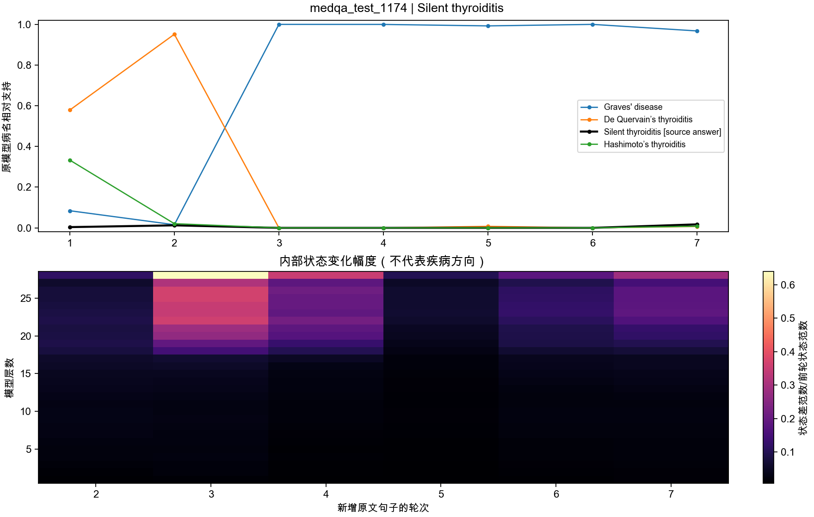

# medqa_test_1174：Silent thyroiditis

来源：MedQA四选项test，第1174行（零起始）。来源答案只用于完整题目评价。路径：在其他疾病间变动。下图没有用DDxPlus探针解码MedQA病名。

What is the most likely diagnosis?

| 轮 | 原模型首选 | 来源答案支持 | 本轮新增原文 |
|---|---|---:|---|
| 1 | De Quervain’s thyroiditis | 0.0037 | A 40-year-old woman presents to her family physician with a 3-week history of swollen neck. |
| 2 | De Quervain’s thyroiditis | 0.0125 | The small, round, and painless swelling, which was detected 3 weeks ago in the middle of her neck, has now increased in size. |
| 3 | Graves' disease | 0.0000 | The swelling is associated with sweaty palms and soles, insomnia, irritability, nervousness, and fatigue; however, the patient does not complain of fever, cervical lymphadenopathy, weight loss, vision problems, or body swelling. |
| 4 | Graves' disease | 0.0000 | The patient’s medical history is negative for similar symptoms or a thyroid disorder. |
| 5 | Graves' disease | 0.0000 | The vital signs are within normal limits. |
| 6 | Graves' disease | 0.0000 | Local examination reveals a 3 x 3 cm round, non-tender, non-fluctuant, and non-pulsatile swelling in the anterior triangle of her neck. |
| 7 | Graves' disease | 0.0172 | The patient carries a total white blood cell count of 10,200/mm3, including 70% neutrophils, 30% lymphocytes, and zero eosinophils.The erythrocyte sedimentation rate is 20 mm/hr (normal, 0–29 mm/hr). |

| 完整题目控制 | 原模型首选 | 来源答案支持改变 |
|---|---|---:|
| reverse | Graves' disease | -0.0172 |
| shuffle | Graves' disease | -0.0172 |
| wrong_history | Graves' disease | -0.0172 |

原题选项：{"A": "Graves' disease", "B": "De Quervain’s thyroiditis", "C": "Silent thyroiditis", "D": "Hashimoto’s thyroiditis"}
