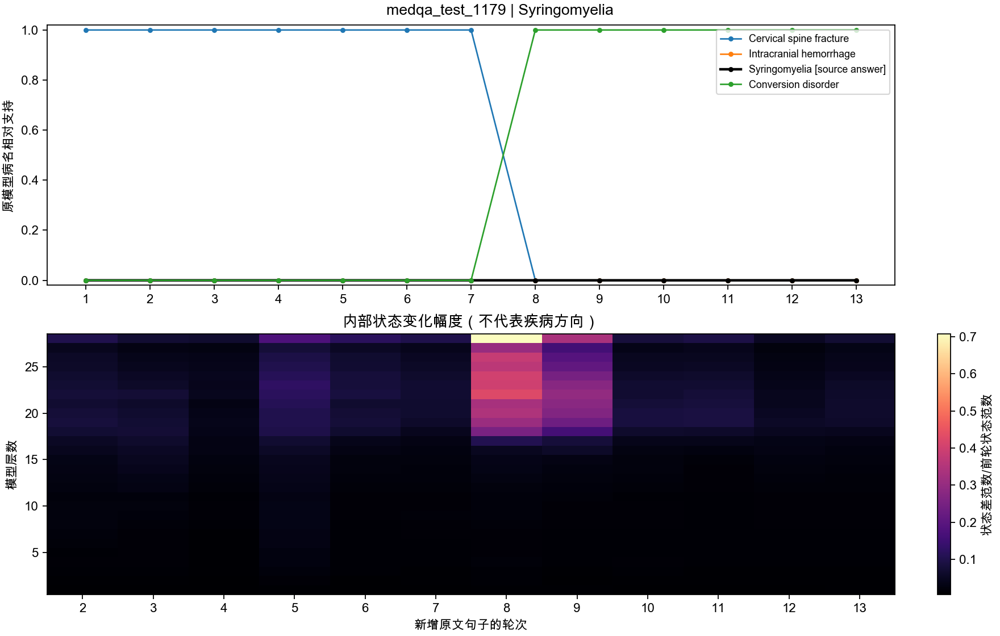

# medqa_test_1179：Syringomyelia

来源：MedQA四选项test，第1179行（零起始）。来源答案只用于完整题目评价。路径：在其他疾病间变动。下图没有用DDxPlus探针解码MedQA病名。

Which of the following is the most likely diagnosis?

| 轮 | 原模型首选 | 来源答案支持 | 本轮新增原文 |
|---|---|---:|---|
| 1 | Cervical spine fracture | 0.0000 | A 17-year-old male presents to the emergency department after a motor vehicle accident. |
| 2 | Cervical spine fracture | 0.0000 | The patient was an unrestrained driver in a head-on collision. |
| 3 | Cervical spine fracture | 0.0000 | He has a past medical history of asthma, depression, and anxiety. |
| 4 | Cervical spine fracture | 0.0000 | He is not currently taking any medications. |
| 5 | Cervical spine fracture | 0.0000 | His temperature is 99.5°F (37.5°C), blood pressure is 90/60 mmHg, pulse is 115/min, respirations are 22/min, and oxygen saturation is 99% on room air. |
| 6 | Cervical spine fracture | 0.0000 | The patient's cardiopulmonary exam is within normal limits. |
| 7 | Cervical spine fracture | 0.0000 | The patient is breathing on his own and has strong distal pulses. |
| 8 | Conversion disorder | 0.0000 | Ultimately, the patient is discharged with follow up instructions after no significant fractures or injuries are found. |
| 9 | Conversion disorder | 0.0000 | The patient then presents 4 months later to his primary doctor with weakness. |
| 10 | Conversion disorder | 0.0000 | The patient's strength in his upper extremities is 1/5. |
| 11 | Conversion disorder | 0.0000 | He has reduced sensation in his upper extremities as well. |
| 12 | Conversion disorder | 0.0000 | The patient's lower extremities reveal 5/5 strength with intact sensation. |
| 13 | Conversion disorder | 0.0000 | A chest radiograph and basic labs are ordered. |

| 完整题目控制 | 原模型首选 | 来源答案支持改变 |
|---|---|---:|
| reverse | Conversion disorder | +0.0000 |
| shuffle | Conversion disorder | +0.0000 |
| wrong_history | Conversion disorder | +0.0000 |

原题选项：{"A": "Cervical spine fracture", "B": "Intracranial hemorrhage", "C": "Syringomyelia", "D": "Conversion disorder"}
