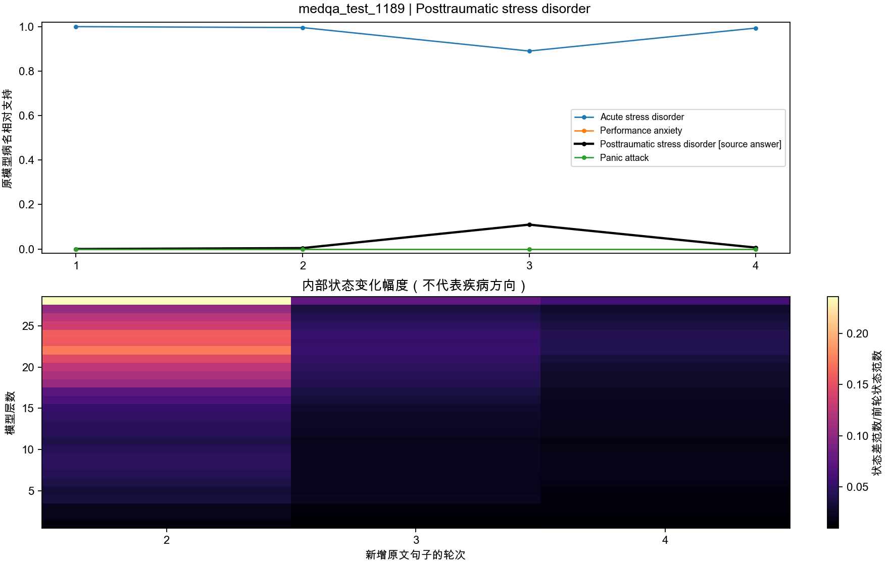

# medqa_test_1189：Posttraumatic stress disorder

来源：MedQA四选项test，第1189行（零起始）。来源答案只用于完整题目评价。路径：始终固定另一病。下图没有用DDxPlus探针解码MedQA病名。

What is the most likely diagnosis?

| 轮 | 原模型首选 | 来源答案支持 | 本轮新增原文 |
|---|---|---:|---|
| 1 | Acute stress disorder | 0.0000 | A 28-year-old male presents with a recent onset of upsetting dreams, anxiety, and disturbing flashbacks. |
| 2 | Acute stress disorder | 0.0042 | The patient reports that he returned from active duty in Iraq 3 months ago and was adjusting to life back at home until about 7 weeks ago when he began having intense fear of loud noises and seeing sudden flashbacks to bombing attacks he endured during his time in Iraq. |
| 3 | Acute stress disorder | 0.1097 | He had to take a leave from his army instructor duties as he was not able to handle the familiar settings of practice shooting ranges and sudden loud explosions during battalion training. |
| 4 | Acute stress disorder | 0.0065 | After refusing to leave his house, he was finally persuaded by his wife to visit your clinic. |

| 完整题目控制 | 原模型首选 | 来源答案支持改变 |
|---|---|---:|
| reverse | Posttraumatic stress disorder | +0.9488 |
| shuffle | Acute stress disorder | +0.0786 |
| wrong_history | Acute stress disorder | -0.0065 |

原题选项：{"A": "Acute stress disorder", "B": "Performance anxiety", "C": "Posttraumatic stress disorder", "D": "Panic attack"}
