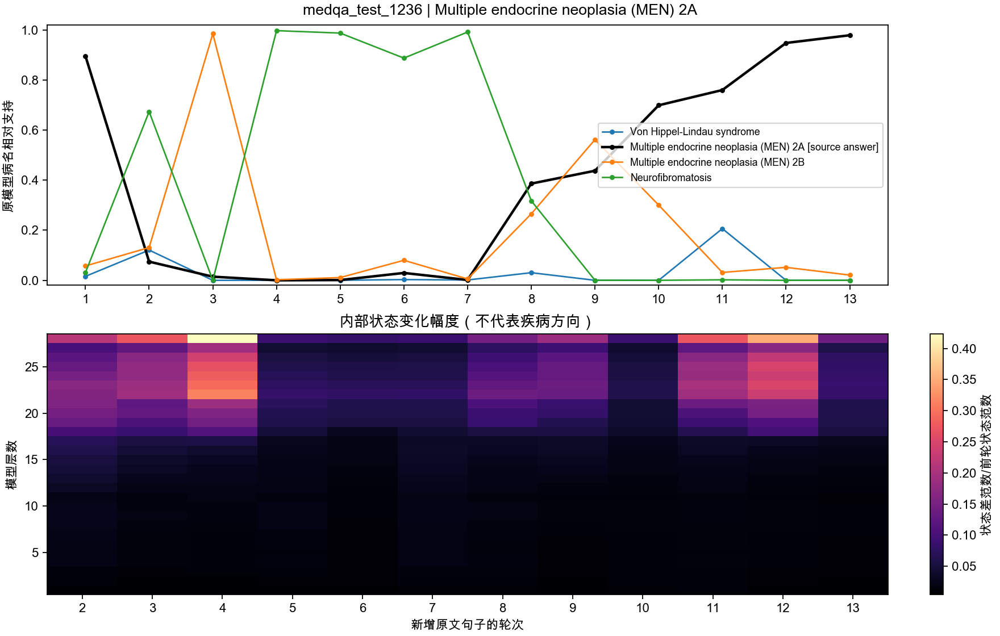

# medqa_test_1236：Multiple endocrine neoplasia (MEN) 2A

来源：MedQA四选项test，第1236行（零起始）。来源答案只用于完整题目评价。路径：曾离开来源病，最后回来。下图没有用DDxPlus探针解码MedQA病名。

Which of the following is the most likely diagnosis?

| 轮 | 原模型首选 | 来源答案支持 | 本轮新增原文 |
|---|---|---:|---|
| 1 | Multiple endocrine neoplasia (MEN) 2A | 0.8962 | A 45-year-old woman presents to the physician with a history of headache, palpitations, and episodic diaphoresis. |
| 2 | Neurofibromatosis | 0.0746 | She was diagnosed with hypertension in the past and is now regularly taking antihypertensive medication (amlodipine 10 mg once daily). |
| 3 | Multiple endocrine neoplasia (MEN) 2B | 0.0145 | She has had a diffuse thyroid swelling for the past 4 months. |
| 4 | Neurofibromatosis | 0.0001 | She complains of pain in the long bones of her arms and legs for the past 3 months. |
| 5 | Neurofibromatosis | 0.0011 | She is slightly built, appears thin, and is anxious and apprehensive. |
| 6 | Neurofibromatosis | 0.0294 | Her skin is moist and warm. |
| 7 | Neurofibromatosis | 0.0014 | Her weight is 45 kg (99.2 lb) and height is 146 cm (4 ft 7 in); BMI is 21.12 kg/m2. |
| 8 | Multiple endocrine neoplasia (MEN) 2A | 0.3863 | Her pulse is 116/min, the blood pressure is 196/102 mm Hg, the respiratory rate is 29/min, and the temperature is 37.2°C (99.0°F). |
| 9 | Multiple endocrine neoplasia (MEN) 2B | 0.4377 | Diffuse and firm thyromegaly is present. |
| 10 | Multiple endocrine neoplasia (MEN) 2A | 0.6992 | Her upper extremities exhibit fine tremors during an anxiety attack. |
| 11 | Multiple endocrine neoplasia (MEN) 2A | 0.7601 | The laboratory test results reveal elevated 24-hour urinary VMA and metanephrines. |
| 12 | Multiple endocrine neoplasia (MEN) 2A | 0.9482 | Serum epinephrine, calcitonin, and parathormone levels are also elevated. |
| 13 | Multiple endocrine neoplasia (MEN) 2A | 0.9790 | Hypercalcemia and hyperglycemia are also noted. |

| 完整题目控制 | 原模型首选 | 来源答案支持改变 |
|---|---|---:|
| reverse | Multiple endocrine neoplasia (MEN) 2A | -0.2798 |
| shuffle | Multiple endocrine neoplasia (MEN) 2A | +0.0152 |
| wrong_history | Neurofibromatosis | -0.7515 |

原题选项：{"A": "Von Hippel-Lindau syndrome", "B": "Multiple endocrine neoplasia (MEN) 2A", "C": "Multiple endocrine neoplasia (MEN) 2B", "D": "Neurofibromatosis"}
