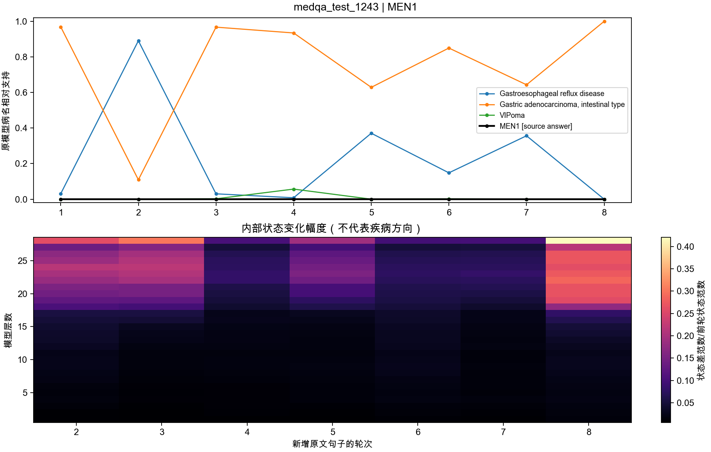

# medqa_test_1243：MEN1

来源：MedQA四选项test，第1243行（零起始）。来源答案只用于完整题目评价。路径：在其他疾病间变动。下图没有用DDxPlus探针解码MedQA病名。

Which of the following is the most likely diagnosis?

| 轮 | 原模型首选 | 来源答案支持 | 本轮新增原文 |
|---|---|---:|---|
| 1 | Gastric adenocarcinoma, intestinal type | 0.0000 | A 26-year-old man presents to the office complaining of persistent epigastric pain for the past 2 months. |
| 2 | Gastroesophageal reflux disease | 0.0000 | He states that his pain is worse a few hours after he eats. |
| 3 | Gastric adenocarcinoma, intestinal type | 0.0000 | His father had similar symptoms. |
| 4 | Gastric adenocarcinoma, intestinal type | 0.0002 | Past medical history is insignificant. |
| 5 | Gastric adenocarcinoma, intestinal type | 0.0000 | He is a non-smoker and does not drink alcohol. |
| 6 | Gastric adenocarcinoma, intestinal type | 0.0000 | The vital signs include blood pressure 120/90 mm Hg, heart rate 83/min, and temperature 37.0°C (98.6°F). |
| 7 | Gastric adenocarcinoma, intestinal type | 0.0000 | Physical examination is insignificant except for mild epigastric tenderness. |
| 8 | Gastric adenocarcinoma, intestinal type | 0.0000 | A metabolic panel reveals the following:
Serum sodium 136 mEq/L
Serum potassium 4.2 mEq/L
Calcium 13.2 mg/dL
Bicarbonate 26 mEq/L
Upper gastrointestinal endoscopy reveals multiple duodenal ulcers. |

| 完整题目控制 | 原模型首选 | 来源答案支持改变 |
|---|---|---:|
| reverse | Gastric adenocarcinoma, intestinal type | +0.0000 |
| shuffle | Gastric adenocarcinoma, intestinal type | +0.0000 |
| wrong_history | VIPoma | +0.0015 |

原题选项：{"A": "Gastroesophageal reflux disease", "B": "Gastric adenocarcinoma, intestinal type", "C": "VIPoma", "D": "MEN1"}
