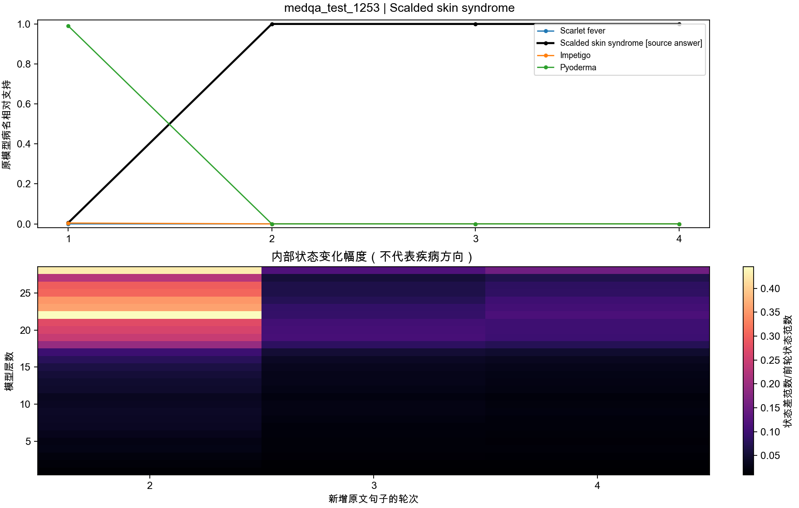

# medqa_test_1253：Scalded skin syndrome

来源：MedQA四选项test，第1253行（零起始）。来源答案只用于完整题目评价。路径：转向来源病后保持。下图没有用DDxPlus探针解码MedQA病名。

What is the most likely diagnosis in this patient?

| 轮 | 原模型首选 | 来源答案支持 | 本轮新增原文 |
|---|---|---:|---|
| 1 | Pyoderma | 0.0055 | A 7 -day-old newborn boy presents to the emergency department with a history of fever, irritability, and generalized erythema. |
| 2 | Scalded skin syndrome | 1.0000 | During the first 2 days of clinical manifestations, the parents of the child tried to control the symptoms using acetaminophen; however, the newborn continued to be ill, and blisters were noticeable around the buttocks, hands, and feet. |
| 3 | Scalded skin syndrome | 1.0000 | During the physical examination, the vital signs include body temperature 39.0°C (102.3°F), heart rate 130/min, and respiratory rate 45/min. |
| 4 | Scalded skin syndrome | 1.0000 | Ears, nose, and oral mucosa preserved their integrity, while the skin presents with diffuse blanching erythema and flaccid blisters with a positive Nikolsky’s sign. |

| 完整题目控制 | 原模型首选 | 来源答案支持改变 |
|---|---|---:|
| reverse | Scalded skin syndrome | +0.0000 |
| shuffle | Scalded skin syndrome | +0.0000 |
| wrong_history | Scarlet fever | -0.9994 |

原题选项：{"A": "Scarlet fever", "B": "Scalded skin syndrome", "C": "Impetigo", "D": "Pyoderma"}
