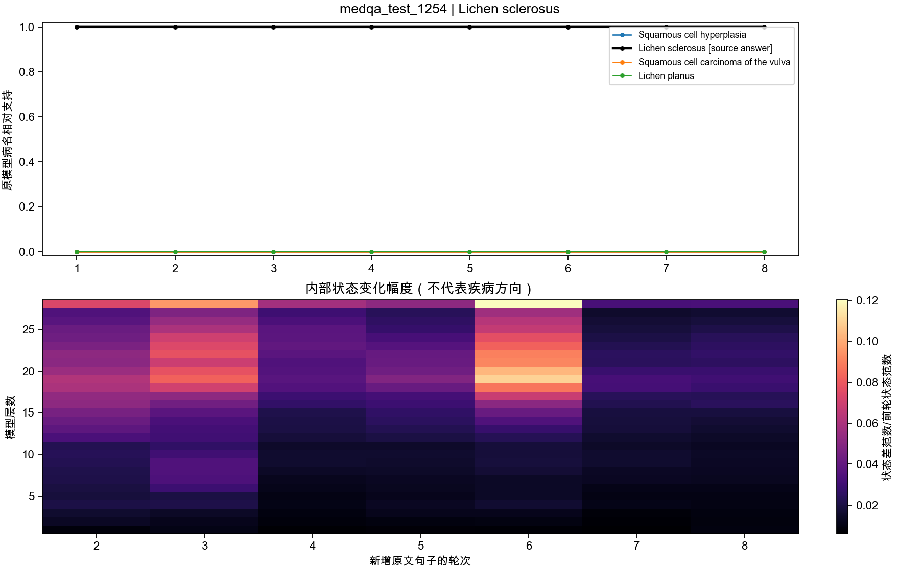

# medqa_test_1254：Lichen sclerosus

来源：MedQA四选项test，第1254行（零起始）。来源答案只用于完整题目评价。路径：始终首选来源病。下图没有用DDxPlus探针解码MedQA病名。

Which of the following is the most likely diagnosis?

| 轮 | 原模型首选 | 来源答案支持 | 本轮新增原文 |
|---|---|---:|---|
| 1 | Lichen sclerosus | 1.0000 | A 60-year-old woman presents to the outpatient clinic complaining of severe vulvar itching that has been gradually worsening for the past year. |
| 2 | Lichen sclerosus | 1.0000 | She mentions that she has tried over-the-counter lubricants, but lubricants do not seem to provide substantial relief. |
| 3 | Lichen sclerosus | 0.9998 | Her medical history is remarkable for diet-controlled type 2 diabetes mellitus and hypertension treated with hydrochlorothiazide. |
| 4 | Lichen sclerosus | 0.9999 | Menopause occurred at 52 years of age. |
| 5 | Lichen sclerosus | 0.9999 | She has been sexually active with her husband until recently and reports severe pain during vaginal intercourse. |
| 6 | Lichen sclerosus | 1.0000 | The physical examination reveals dry, thin, white plaque-like lesions in the vulvar area with atrophy of the labia minora. |
| 7 | Lichen sclerosus | 1.0000 | The clitoris appears retracted. |
| 8 | Lichen sclerosus | 1.0000 | The perianal skin appears pale and wrinkled. |

| 完整题目控制 | 原模型首选 | 来源答案支持改变 |
|---|---|---:|
| reverse | Lichen sclerosus | -0.0000 |
| shuffle | Lichen sclerosus | -0.0000 |
| wrong_history | Lichen sclerosus | -0.0001 |

原题选项：{"A": "Squamous cell hyperplasia", "B": "Lichen sclerosus", "C": "Squamous cell carcinoma of the vulva", "D": "Lichen planus"}
