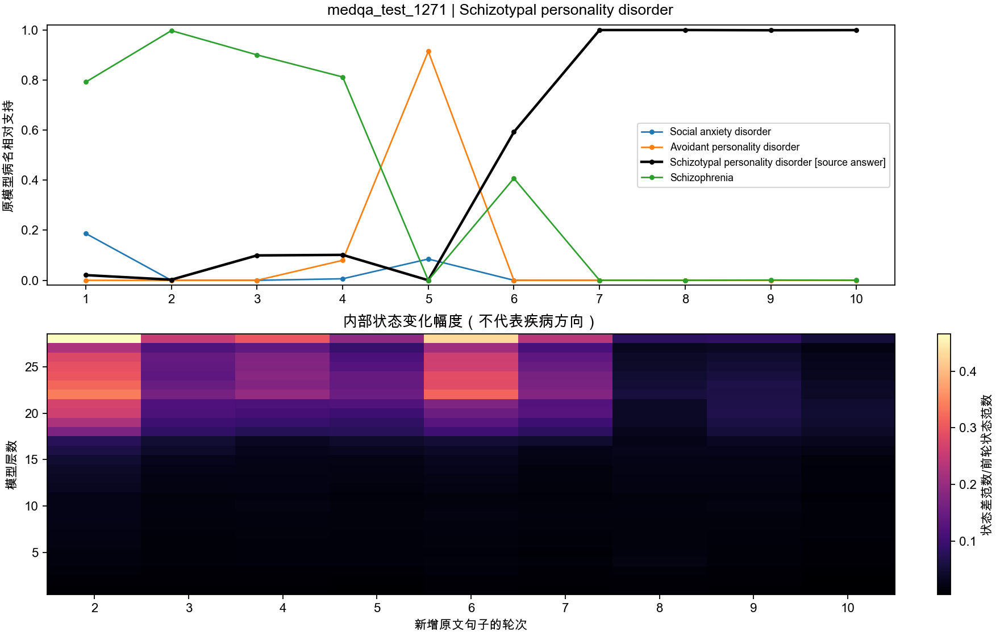

# medqa_test_1271：Schizotypal personality disorder

来源：MedQA四选项test，第1271行（零起始）。来源答案只用于完整题目评价。路径：转向来源病后保持。下图没有用DDxPlus探针解码MedQA病名。

Which of the following is the most likely diagnosis?

| 轮 | 原模型首选 | 来源答案支持 | 本轮新增原文 |
|---|---|---:|---|
| 1 | Schizophrenia | 0.0208 | A 19-year-old man is brought to the physician by his mother because she is worried about his strange behavior. |
| 2 | Schizophrenia | 0.0026 | Over the past 3 years, he has been dressing all in black and wears a long black coat, even in the summer. |
| 3 | Schizophrenia | 0.0995 | The mother reports that her son has always had difficulties fitting in. |
| 4 | Schizophrenia | 0.1016 | He does not have any friends and spends most of his time in his room playing online games. |
| 5 | Avoidant personality disorder | 0.0002 | He is anxious at college because he is uncomfortable around other people, and his academic performance is poor. |
| 6 | Schizotypal personality disorder | 0.5925 | Rather than doing his coursework, he spends most of his time reading up on paranormal phenomena, especially demons. |
| 7 | Schizotypal personality disorder | 0.9998 | He says that he has never seen any demons, but sometimes there are signs of their presence. |
| 8 | Schizotypal personality disorder | 0.9999 | For example, a breeze in an enclosed room is likely the “breath of a demon”. |
| 9 | Schizotypal personality disorder | 0.9990 | Mental status examination shows laborious speech. |
| 10 | Schizotypal personality disorder | 0.9995 | The patient avoids eye contact. |

| 完整题目控制 | 原模型首选 | 来源答案支持改变 |
|---|---|---:|
| reverse | Schizotypal personality disorder | -0.0006 |
| shuffle | Schizotypal personality disorder | -0.0027 |
| wrong_history | Schizotypal personality disorder | -0.0248 |

原题选项：{"A": "Social anxiety disorder", "B": "Avoidant personality disorder", "C": "Schizotypal personality disorder", "D": "Schizophrenia"}
