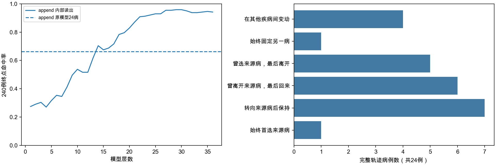
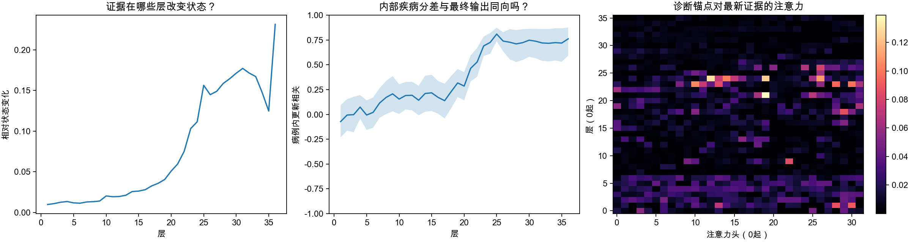
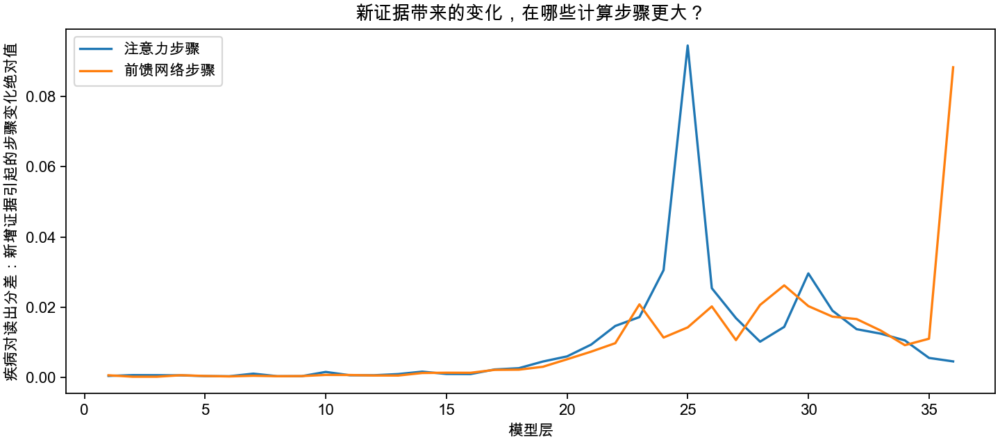

# 新队列：4b模型的医学判断怎样形成和改变

新增240个DDxPlus test患者，24病×10例，与既有病例没有相同事实集合。旧120例训练的读出器完全冻结。24例预先选定，逐条记录184次证据加入；覆盖全部24种病。此处所有统计使用新患者，不合并旧探索病例。

| 完整病例呈现 | 原模型49病 | 原模型限制24病 | 最后一层内部24病读出 |
|---|---|---|---|
| append | 59.17% [52.92, 65.00] | 66.25% [60.00, 72.08] | 94.17% [90.83, 97.08] |

这里“内部读出”是从冻结模型的状态中训练一个外部小分类器；原模型是逐个比较完整候选病名的生成分数。统一24病的两列用于公平比较候选范围。读出命中意味着状态含有可识别的标签信息，不能直接等同于模型自己在内部作出诊断。

## 信念的变化不是只有一种

始终首选来源病 1例；转向来源病后保持 7例；曾离开来源病，最后回来 6例；曾选来源病，最后离开 5例；始终固定另一病 1例；在其他疾病间变动 4例。

共184次证据更新，首选改变62次，任意病名支持单次改变至少50个百分点53次。至少一次首选改变的病例比例为91.67% [79.17, 100.00]；曾命中来源诊断又离开的病例比例为45.83% [25.00, 66.67]。这些是相对完整病例来源诊断的路径描述，并没有把不完整证据下的判断一概判错。

## 往模型里面看

最后一层疾病分差更新与原输出更新的病例内相关为0.7623 [0.5929, 0.8760]。图中左侧测量状态移动幅度，中间比较疾病方向与输出的同步性，右侧显示锚点向最新证据分配的注意力。全部先在患者内汇总，再跨患者平均。注意力高低本身不证明因果，因果结果单独报告。

进一步将同一层的疾病分差更新分成：从前一层继承的变化、注意力步骤新增的变化、前馈网络步骤新增的变化。三者在固定读出坐标中严格相加，完整逐轮数值见layer_updates.csv。图展示各步骤变化的平均绝对值，用于定位计算位置；因果作用由独立干预判断。

模型权重在推理中没有改变；改变的是每轮输入引起的内部激活、注意力分配和病名输出分数。逐层读出排名不作为各层自行报告的疾病概率。分数归一化在固定候选字符串内进行，不是患者患病概率。

[全部逐例图谱](CASE_ATLAS.md) · [逐轮变化](prefix_trajectories.csv) · [每条证据](evidence_updates.csv) · [每层更新](layer_updates.csv) · [按疾病组汇总](family_endpoints.csv) · [精确结果](summary.json)
