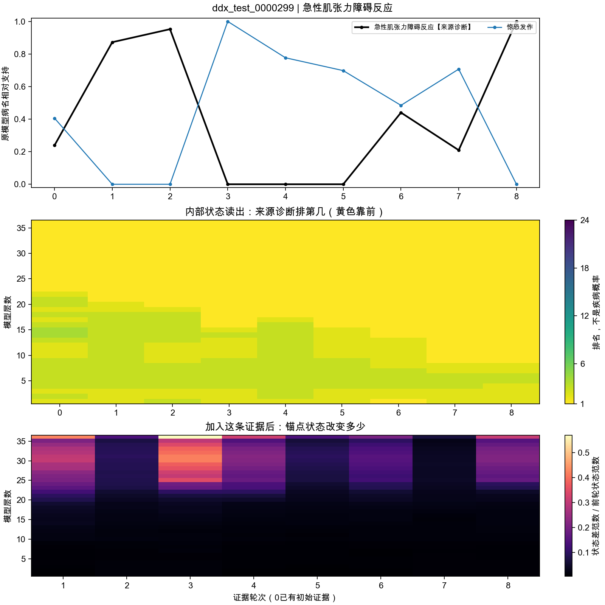

# ddx_test_0000299：急性肌张力障碍反应

DDxPlus test 原始第299行（零起始）。轨迹类型：曾离开来源病，最后回来。来源诊断适用于完整病例；中间轮没有逐轮医学标准答案。

| 轮 | 原模型首选（49病） | 来源诊断相对支持 | 第18层读出（24病） | 第27层读出（24病） | 第36层读出（24病） |
|---|---|---:|---|---|---|
| 0 | 惊恐发作 | 0.2389 | 吉兰-巴雷综合征 | 急性肌张力障碍反应 | 急性肌张力障碍反应 |
| 1 | 急性肌张力障碍反应 | 0.8722 | 吉兰-巴雷综合征 | 急性肌张力障碍反应 | 急性肌张力障碍反应 |
| 2 | 急性肌张力障碍反应 | 0.9522 | 吉兰-巴雷综合征 | 急性肌张力障碍反应 | 急性肌张力障碍反应 |
| 3 | 惊恐发作 | 0.0000 | 急性肌张力障碍反应 | 急性肌张力障碍反应 | 急性肌张力障碍反应 |
| 4 | 惊恐发作 | 0.0000 | 急性肌张力障碍反应 | 急性肌张力障碍反应 | 急性肌张力障碍反应 |
| 5 | 惊恐发作 | 0.0000 | 急性肌张力障碍反应 | 急性肌张力障碍反应 | 急性肌张力障碍反应 |
| 6 | 惊恐发作 | 0.4400 | 急性肌张力障碍反应 | 急性肌张力障碍反应 | 急性肌张力障碍反应 |
| 7 | 惊恐发作 | 0.2093 | 急性肌张力障碍反应 | 急性肌张力障碍反应 | 急性肌张力障碍反应 |
| 8 | 急性肌张力障碍反应 | 1.0000 | 急性肌张力障碍反应 | 急性肌张力障碍反应 | 急性肌张力障碍反应 |

## 原始证据

**第0轮** E_193

面部、颈部或其他部位出现令人困扰的肌痉挛：是

- Do you have annoying muscle spasms in your face, neck or any other part of your body? **Yes**

**第1轮** E_205

突然张口困难、不能张口或张口时下颌疼痛：是

- Do you suddenly have difficulty or an inability to open your mouth or have jaw pain when opening it? **Yes**

**第2轮** E_204

近四周出国旅行：否

- Have you traveled out of the country in the last 4 weeks? **No**

**第3轮** E_128

曾短暂窒息且无法呼吸或说话：是

- Have you ever felt like you were suffocating for a very short time associated with inability to breathe or speak? **Yes**

**第4轮** E_66

明显气短或呼吸困难：是

- Are you experiencing shortness of breath or difficulty breathing in a significant way? **Yes**

**第5轮** E_172

难以睁开或抬起一侧/双侧眼睑：是

- Do you have a hard time opening/raising one or both eyelids? **Yes**

**第6轮** E_15

过去7天开始或服用抗精神病药：是

- Have you started or taken any antipsychotic medication within the last 7 days? **Yes**

**第7轮** E_180

无法控制眼球方向：是

- Are you unable to control the direction of your eyes? **Yes**

**第8轮** E_147

近期因恶心、躁动、中毒或攻击行为住院并接受静脉/肌肉注射药物：是

- Have you been treated in hospital recently for nausea, agitation, intoxication or aggressive behavior and received medication via an intravenous or intramuscular route? **Yes**
