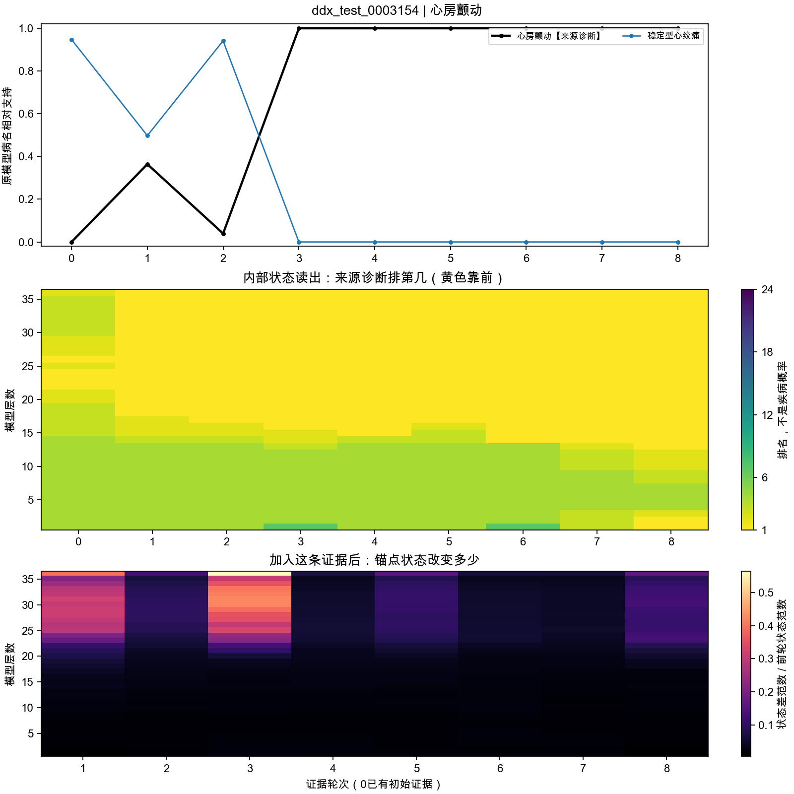

# ddx_test_0003154：心房颤动

DDxPlus test 原始第3154行（零起始）。轨迹类型：转向来源病后保持。来源诊断适用于完整病例；中间轮没有逐轮医学标准答案。

| 轮 | 原模型首选（49病） | 来源诊断相对支持 | 第18层读出（24病） | 第27层读出（24病） | 第36层读出（24病） |
|---|---|---:|---|---|---|
| 0 | 稳定型心绞痛 | 0.0001 | 重症肌无力 | 稳定型心绞痛 | 稳定型心绞痛 |
| 1 | 稳定型心绞痛 | 0.3641 | 心房颤动 | 心房颤动 | 心房颤动 |
| 2 | 稳定型心绞痛 | 0.0395 | 心房颤动 | 心房颤动 | 心房颤动 |
| 3 | 心房颤动 | 1.0000 | 心房颤动 | 心房颤动 | 心房颤动 |
| 4 | 心房颤动 | 1.0000 | 心房颤动 | 心房颤动 | 心房颤动 |
| 5 | 心房颤动 | 1.0000 | 心房颤动 | 心房颤动 | 心房颤动 |
| 6 | 心房颤动 | 1.0000 | 心房颤动 | 心房颤动 | 心房颤动 |
| 7 | 心房颤动 | 1.0000 | 心房颤动 | 心房颤动 | 心房颤动 |
| 8 | 心房颤动 | 1.0000 | 心房颤动 | 心房颤动 | 心房颤动 |

## 原始证据

**第0轮** E_218

活动时症状加重、休息时缓解：是

- Do you have symptoms that are increased with physical exertion but alleviated with rest? **Yes**

**第1轮** E_139

有已知心脏缺陷：是

- Do you have a known heart defect? **Yes**

**第2轮** E_104

有高血压或服用降压药：是

- Do you have high blood pressure or do you take medications to treat high blood pressure? **Yes**

**第3轮** E_164

心跳非常不规律或紊乱：是

- Do you feel your heart is beating very irregularly or in a disorganized pattern? **Yes**

**第4轮** E_70

相比同身高者明显超重：是

- Are you significantly overweight compared to people of the same height as you? **Yes**

**第5轮** E_66

明显气短或呼吸困难：是

- Are you experiencing shortness of breath or difficulty breathing in a significant way? **Yes**

**第6轮** E_204

近四周出国旅行：否

- Have you traveled out of the country in the last 4 weeks? **No**

**第7轮** E_76

轻微头晕或头重脚轻：是

- Do you feel slightly dizzy or lightheaded? **Yes**

**第8轮** E_31

患严重慢阻肺：是

- Do you have severe Chronic Obstructive Pulmonary Disease (COPD)? **Yes**
