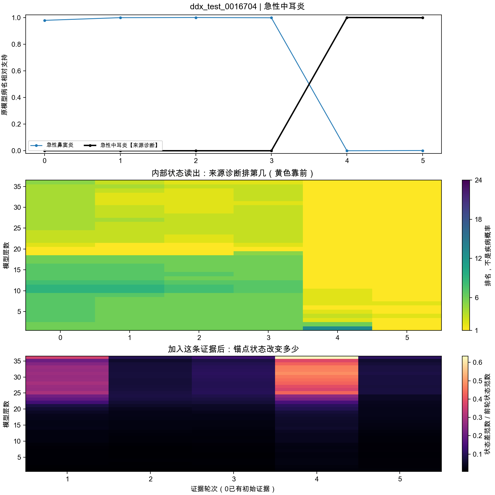

# ddx_test_0016704：急性中耳炎

DDxPlus test 原始第16704行（零起始）。轨迹类型：转向来源病后保持。来源诊断适用于完整病例；中间轮没有逐轮医学标准答案。

| 轮 | 原模型首选（49病） | 来源诊断相对支持 | 第18层读出（24病） | 第27层读出（24病） | 第36层读出（24病） |
|---|---|---:|---|---|---|
| 0 | 急性鼻窦炎 | 0.0000 | 重症肌无力 | 上呼吸道感染 | 上呼吸道感染 |
| 1 | 急性鼻窦炎 | 0.0000 | 重症肌无力 | 上呼吸道感染 | 上呼吸道感染 |
| 2 | 急性鼻窦炎 | 0.0000 | 支气管痉挛/哮喘急性发作 | 上呼吸道感染 | 上呼吸道感染 |
| 3 | 急性鼻窦炎 | 0.0000 | 急性肌张力障碍反应 | 上呼吸道感染 | 上呼吸道感染 |
| 4 | 急性中耳炎 | 0.9999 | 急性中耳炎 | 急性中耳炎 | 急性中耳炎 |
| 5 | 急性中耳炎 | 0.9982 | 急性中耳炎 | 急性中耳炎 | 急性中耳炎 |

## 原始证据

**第0轮** E_201

咳嗽：是

- Do you have a cough? **Yes**

**第1轮** E_181

鼻塞或流清鼻涕：是

- Do you have nasal congestion or a clear runny nose? **Yes**

**第2轮** E_209

疫苗按时接种：是

- Are your vaccinations up to date? **Yes**

**第3轮** E_114

近期更易怒或情绪很不稳定：是

- Are you more irritable or has your mood been very unstable recently? **Yes**

**第4轮** E_53

本次就诊相关疼痛（同时揭示性质、位置、程度、放射等记录）：是；疼痛性质：sensitive; sharp；疼痛部位：ear(R); ear(L)；疼痛强度记录：原始量表值8（0–10，端点含义未给出）；疼痛放射部位：nowhere；疼痛定位精确度记录：原始量表值9（0–10，端点含义未给出）；疼痛起病速度记录：原始量表值3（0–10，端点含义未给出）

- Do you have pain somewhere, related to your reason for consulting? **Yes**
- Characterize your pain: **sensitive; sharp**
- Do you feel pain somewhere? **ear(R); ear(L)**
- How intense is the pain? **Recorded scale value 8 on the dataset's 0-10 scale; endpoint meanings are unspecified**
- Does the pain radiate to another location? **nowhere**
- How precisely is the pain located? **Recorded scale value 9 on the dataset's 0-10 scale; endpoint meanings are unspecified**
- How fast did the pain appear? **Recorded scale value 3 on the dataset's 0-10 scale; endpoint meanings are unspecified**

**第5轮** E_204

近四周出国旅行：否

- Have you traveled out of the country in the last 4 weeks? **No**
