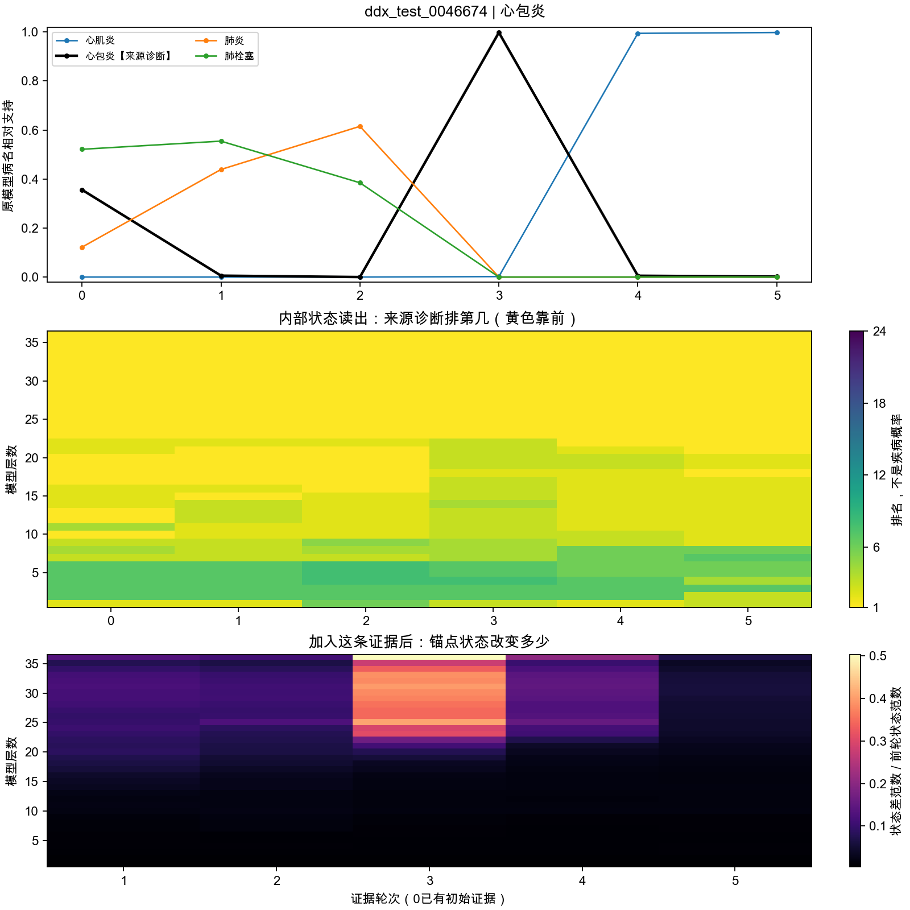

# ddx_test_0046674：心包炎

DDxPlus test 原始第46674行（零起始）。轨迹类型：曾选来源病，最后离开。来源诊断适用于完整病例；中间轮没有逐轮医学标准答案。

| 轮 | 原模型首选（49病） | 来源诊断相对支持 | 第18层读出（24病） | 第27层读出（24病） | 第36层读出（24病） |
|---|---|---:|---|---|---|
| 0 | 肺栓塞 | 0.3562 | 心包炎 | 心包炎 | 心包炎 |
| 1 | 肺栓塞 | 0.0057 | 心包炎 | 心包炎 | 心包炎 |
| 2 | 肺炎 | 0.0000 | 心包炎 | 心包炎 | 心包炎 |
| 3 | 心包炎 | 0.9980 | 丛集性头痛 | 心包炎 | 心包炎 |
| 4 | 心肌炎 | 0.0054 | 丛集性头痛 | 心包炎 | 心包炎 |
| 5 | 心肌炎 | 0.0019 | 心包炎 | 心包炎 | 心包炎 |

## 原始证据

**第0轮** E_53

本次就诊相关疼痛（同时揭示性质、位置、程度、放射等记录）：是；疼痛性质：a knife stroke; sharp；疼痛部位：lower chest; upper chest; breast(L)；疼痛强度记录：原始量表值8（0–10，端点含义未给出）；疼痛放射部位：thoracic spine; posterior chest wall(R); posterior chest wall(L)；疼痛定位精确度记录：原始量表值2（0–10，端点含义未给出）；疼痛起病速度记录：原始量表值4（0–10，端点含义未给出）

- Do you have pain somewhere, related to your reason for consulting? **Yes**
- Characterize your pain: **a knife stroke; sharp**
- Do you feel pain somewhere? **lower chest; upper chest; breast(L)**
- How intense is the pain? **Recorded scale value 8 on the dataset's 0-10 scale; endpoint meanings are unspecified**
- Does the pain radiate to another location? **thoracic spine; posterior chest wall(R); posterior chest wall(L)**
- How precisely is the pain located? **Recorded scale value 2 on the dataset's 0-10 scale; endpoint meanings are unspecified**
- How fast did the pain appear? **Recorded scale value 4 on the dataset's 0-10 scale; endpoint meanings are unspecified**

**第1轮** E_220

深吸气使疼痛加重：是

- Do you have pain that is increased when you breathe in deeply? **Yes**

**第2轮** E_204

近四周出国旅行：否

- Have you traveled out of the country in the last 4 weeks? **No**

**第3轮** E_3

曾患心包炎：是

- Have you ever had a pericarditis? **Yes**

**第4轮** E_0

最近有病毒感染：是

- Have you recently had a viral infection? **Yes**

**第5轮** E_217

平躺时症状加重、坐起时缓解：是

- Are your symptoms worse when lying down and alleviated while sitting up? **Yes**
