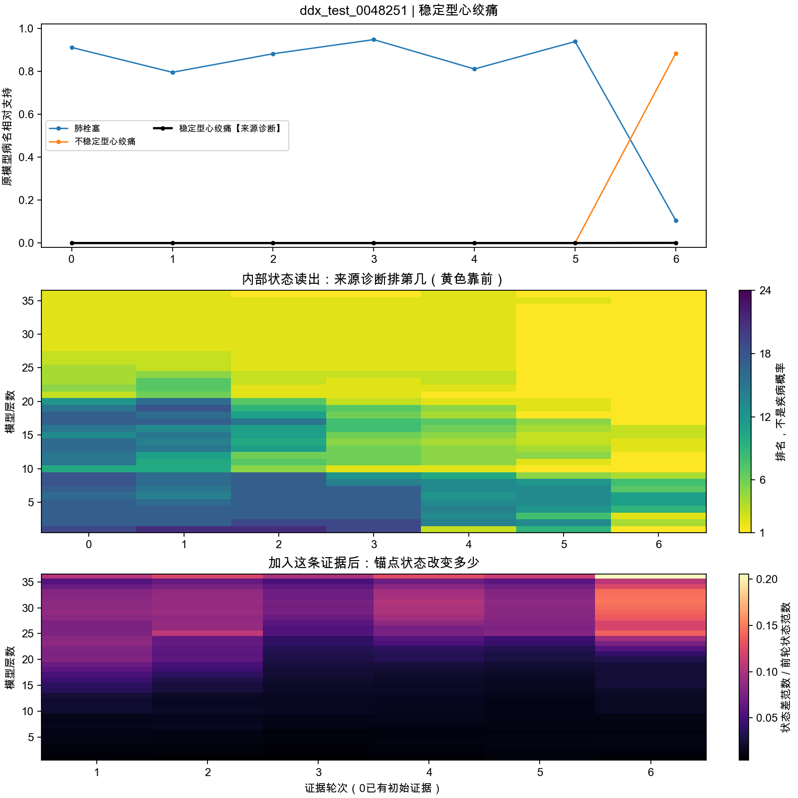

# ddx_test_0048251：稳定型心绞痛

DDxPlus test 原始第48251行（零起始）。轨迹类型：在其他疾病间变动。来源诊断适用于完整病例；中间轮没有逐轮医学标准答案。

| 轮 | 原模型首选（49病） | 来源诊断相对支持 | 第18层读出（24病） | 第27层读出（24病） | 第36层读出（24病） |
|---|---|---:|---|---|---|
| 0 | 肺栓塞 | 0.0000 | 心包炎 | 心包炎 | 心包炎 |
| 1 | 肺栓塞 | 0.0000 | 丛集性头痛 | 心包炎 | 心包炎 |
| 2 | 肺栓塞 | 0.0000 | 丛集性头痛 | 心包炎 | 稳定型心绞痛 |
| 3 | 肺栓塞 | 0.0000 | 丛集性头痛 | 心包炎 | 稳定型心绞痛 |
| 4 | 肺栓塞 | 0.0000 | 丛集性头痛 | 心包炎 | 心包炎 |
| 5 | 肺栓塞 | 0.0000 | 稳定型心绞痛 | 稳定型心绞痛 | 稳定型心绞痛 |
| 6 | 不稳定型心绞痛 | 0.0007 | 稳定型心绞痛 | 稳定型心绞痛 | 稳定型心绞痛 |

## 原始证据

**第0轮** E_53

本次就诊相关疼痛（同时揭示性质、位置、程度、放射等记录）：是；疼痛性质：exhausting；疼痛部位：side of the chest(L); upper chest; breast(R); breast(L); epigastric；疼痛强度记录：原始量表值7（0–10，端点含义未给出）；疼痛放射部位：biceps(R); under the jaw; triceps(L); shoulder(R)；疼痛定位精确度记录：原始量表值3（0–10，端点含义未给出）；疼痛起病速度记录：原始量表值9（0–10，端点含义未给出）

- Do you have pain somewhere, related to your reason for consulting? **Yes**
- Characterize your pain: **exhausting**
- Do you feel pain somewhere? **side of the chest(L); upper chest; breast(R); breast(L); epigastric**
- How intense is the pain? **Recorded scale value 7 on the dataset's 0-10 scale; endpoint meanings are unspecified**
- Does the pain radiate to another location? **biceps(R); under the jaw; triceps(L); shoulder(R)**
- How precisely is the pain located? **Recorded scale value 3 on the dataset's 0-10 scale; endpoint meanings are unspecified**
- How fast did the pain appear? **Recorded scale value 9 on the dataset's 0-10 scale; endpoint meanings are unspecified**

**第1轮** E_78

过量饮酒或酒精依赖：是

- Do you drink alcohol excessively or do you have an addiction to alcohol? **Yes**

**第2轮** E_70

相比同身高者明显超重：是

- Are you significantly overweight compared to people of the same height as you? **Yes**

**第3轮** E_204

近四周出国旅行：否

- Have you traveled out of the country in the last 4 weeks? **No**

**第4轮** E_104

有高血压或服用降压药：是

- Do you have high blood pressure or do you take medications to treat high blood pressure? **Yes**

**第5轮** E_68

Do you have diabetes?：是

- Do you have diabetes? **Yes**

**第6轮** E_218

活动时症状加重、休息时缓解：是

- Do you have symptoms that are increased with physical exertion but alleviated with rest? **Yes**
