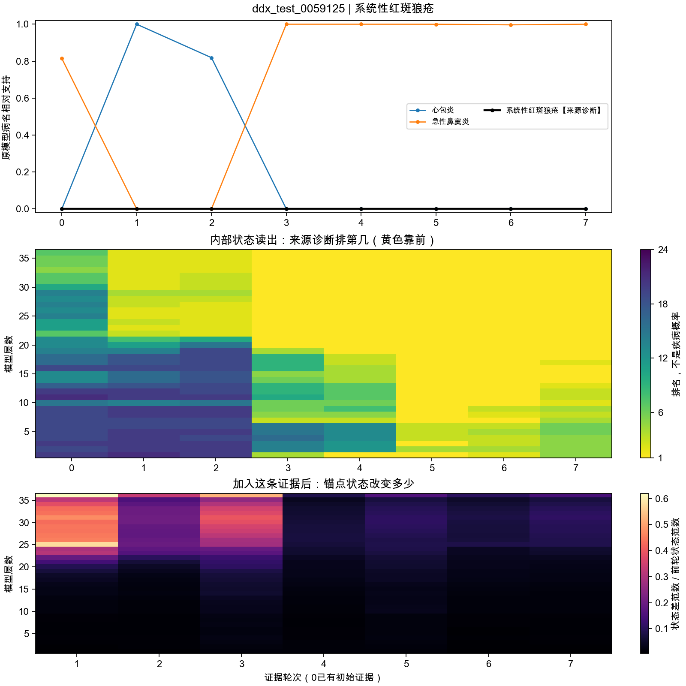

# ddx_test_0059125：系统性红斑狼疮

DDxPlus test 原始第59125行（零起始）。轨迹类型：在其他疾病间变动。来源诊断适用于完整病例；中间轮没有逐轮医学标准答案。

| 轮 | 原模型首选（49病） | 来源诊断相对支持 | 第18层读出（24病） | 第27层读出（24病） | 第36层读出（24病） |
|---|---|---:|---|---|---|
| 0 | 急性鼻窦炎 | 0.0000 | 重症肌无力 | 支气管炎 | 支气管炎 |
| 1 | 心包炎 | 0.0000 | 心房颤动 | 心包炎 | 心包炎 |
| 2 | 心包炎 | 0.0000 | 心房颤动 | 心包炎 | 心包炎 |
| 3 | 急性鼻窦炎 | 0.0000 | 吉兰-巴雷综合征 | 系统性红斑狼疮 | 系统性红斑狼疮 |
| 4 | 急性鼻窦炎 | 0.0000 | 急性中耳炎 | 系统性红斑狼疮 | 系统性红斑狼疮 |
| 5 | 急性鼻窦炎 | 0.0000 | 系统性红斑狼疮 | 系统性红斑狼疮 | 系统性红斑狼疮 |
| 6 | 急性鼻窦炎 | 0.0000 | 系统性红斑狼疮 | 系统性红斑狼疮 | 系统性红斑狼疮 |
| 7 | 急性鼻窦炎 | 0.0000 | 系统性红斑狼疮 | 系统性红斑狼疮 | 系统性红斑狼疮 |

## 原始证据

**第0轮** E_66

明显气短或呼吸困难：是

- Are you experiencing shortness of breath or difficulty breathing in a significant way? **Yes**

**第1轮** E_3

曾患心包炎：是

- Have you ever had a pericarditis? **Yes**

**第2轮** E_79

吸烟：是

- Do you smoke cigarettes? **Yes**

**第3轮** E_129

有自认为与本次就诊相关的皮肤问题（同时揭示颜色、位置、程度等记录）：是；皮疹颜色：red；皮损脱屑：否；皮疹肿胀程度记录：原始量表值0（0–10，端点含义未给出）；皮损部位：cheek(R); nose；皮损大于1厘米：是；瘙痒程度记录：原始量表值1（0–10，端点含义未给出）

- Do you have any lesions, redness or problems on your skin that you believe are related to the condition you are consulting for? **Yes**
- What color is the rash? **red**
- Do your lesions peel off? **No**
- Is the rash swollen? **Recorded scale value 0 on the dataset's 0-10 scale; endpoint meanings are unspecified**
- Where is the affected region located? **cheek(R); nose**
- Is the lesion (or are the lesions) larger than 1cm? **Yes**
- How severe is the itching? **Recorded scale value 1 on the dataset's 0-10 scale; endpoint meanings are unspecified**

**第4轮** E_89

持续疲劳或睡眠不能恢复精力：是

- Do you constantly feel fatigued or do you have non-restful sleep? **Yes**

**第5轮** E_53

本次就诊相关疼痛（同时揭示性质、位置、程度、放射等记录）：是；疼痛性质：sharp；疼痛部位：back of the neck; ankle(L); dorsal aspect of the wrist(R); dorsal aspect of the wrist(L); shoulder(L)；疼痛强度记录：原始量表值5（0–10，端点含义未给出）；疼痛放射部位：nowhere；疼痛定位精确度记录：原始量表值10（0–10，端点含义未给出）；疼痛起病速度记录：原始量表值5（0–10，端点含义未给出）

- Do you have pain somewhere, related to your reason for consulting? **Yes**
- Characterize your pain: **sharp**
- Do you feel pain somewhere? **back of the neck; ankle(L); dorsal aspect of the wrist(R); dorsal aspect of the wrist(L); shoulder(L)**
- How intense is the pain? **Recorded scale value 5 on the dataset's 0-10 scale; endpoint meanings are unspecified**
- Does the pain radiate to another location? **nowhere**
- How precisely is the pain located? **Recorded scale value 10 on the dataset's 0-10 scale; endpoint meanings are unspecified**
- How fast did the pain appear? **Recorded scale value 5 on the dataset's 0-10 scale; endpoint meanings are unspecified**

**第6轮** E_204

近四周出国旅行：否

- Have you traveled out of the country in the last 4 weeks? **No**

**第7轮** E_141

初潮早于12岁：是

- Did you have your first menstrual period before the age of 12? **Yes**
