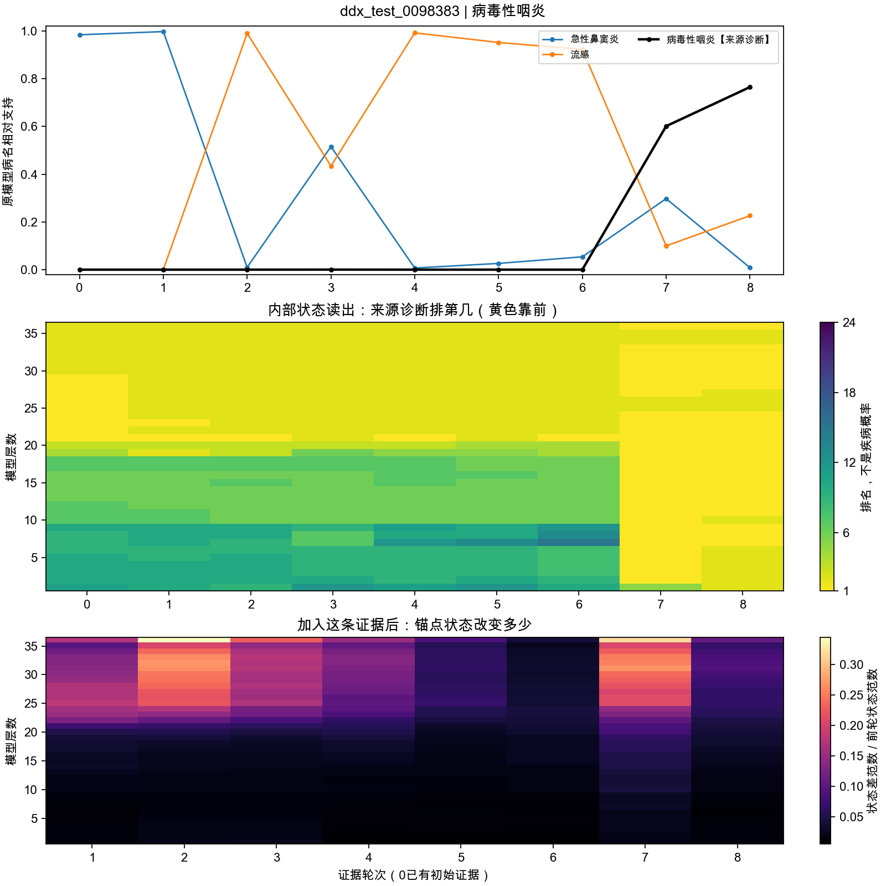

# ddx_test_0098383：病毒性咽炎

DDxPlus test 原始第98383行（零起始）。轨迹类型：转向来源病后保持。来源诊断适用于完整病例；中间轮没有逐轮医学标准答案。

| 轮 | 原模型首选（49病） | 来源诊断相对支持 | 第18层读出（24病） | 第27层读出（24病） | 第36层读出（24病） |
|---|---|---:|---|---|---|
| 0 | 急性鼻窦炎 | 0.0000 | 重症肌无力 | 病毒性咽炎 | 上呼吸道感染 |
| 1 | 急性鼻窦炎 | 0.0000 | 重症肌无力 | 上呼吸道感染 | 上呼吸道感染 |
| 2 | 流感 | 0.0000 | 重症肌无力 | 上呼吸道感染 | 上呼吸道感染 |
| 3 | 急性鼻窦炎 | 0.0002 | 急性肌张力障碍反应 | 上呼吸道感染 | 上呼吸道感染 |
| 4 | 流感 | 0.0000 | 支气管痉挛/哮喘急性发作 | 上呼吸道感染 | 上呼吸道感染 |
| 5 | 流感 | 0.0000 | 支气管痉挛/哮喘急性发作 | 上呼吸道感染 | 上呼吸道感染 |
| 6 | 流感 | 0.0000 | 支气管痉挛/哮喘急性发作 | 上呼吸道感染 | 上呼吸道感染 |
| 7 | 病毒性咽炎 | 0.6014 | 病毒性咽炎 | 病毒性咽炎 | 病毒性咽炎 |
| 8 | 病毒性咽炎 | 0.7652 | 病毒性咽炎 | 上呼吸道感染 | 病毒性咽炎 |

## 原始证据

**第0轮** E_201

咳嗽：是

- Do you have a cough? **Yes**

**第1轮** E_48

与4人或更多人共同居住：是

- Do you live with 4 or more people? **Yes**

**第2轮** E_41

近2周接触过有类似症状的人：是

- Have you been in contact with a person with similar symptoms in the past 2 weeks? **Yes**

**第3轮** E_181

鼻塞或流清鼻涕：是

- Do you have nasal congestion or a clear runny nose? **Yes**

**第4轮** E_227

处于免疫抑制状态：是

- Are you immunosuppressed? **Yes**

**第5轮** E_49

在日托机构就读或工作：是

- Do you attend or work in a daycare? **Yes**

**第6轮** E_204

近四周出国旅行：否

- Have you traveled out of the country in the last 4 weeks? **No**

**第7轮** E_53

本次就诊相关疼痛（同时揭示性质、位置、程度、放射等记录）：是；疼痛性质：sensitive; burning；疼痛部位：tonsil(R); tonsil(L); thyroid cartilage; palace; pharynx；疼痛强度记录：原始量表值6（0–10，端点含义未给出）；疼痛放射部位：nowhere；疼痛定位精确度记录：原始量表值4（0–10，端点含义未给出）；疼痛起病速度记录：原始量表值5（0–10，端点含义未给出）

- Do you have pain somewhere, related to your reason for consulting? **Yes**
- Characterize your pain: **sensitive; burning**
- Do you feel pain somewhere? **tonsil(R); tonsil(L); thyroid cartilage; palace; pharynx**
- How intense is the pain? **Recorded scale value 6 on the dataset's 0-10 scale; endpoint meanings are unspecified**
- Does the pain radiate to another location? **nowhere**
- How precisely is the pain located? **Recorded scale value 4 on the dataset's 0-10 scale; endpoint meanings are unspecified**
- How fast did the pain appear? **Recorded scale value 5 on the dataset's 0-10 scale; endpoint meanings are unspecified**

**第8轮** E_91

发热：是

- Do you have a fever (either felt or measured with a thermometer)? **Yes**
