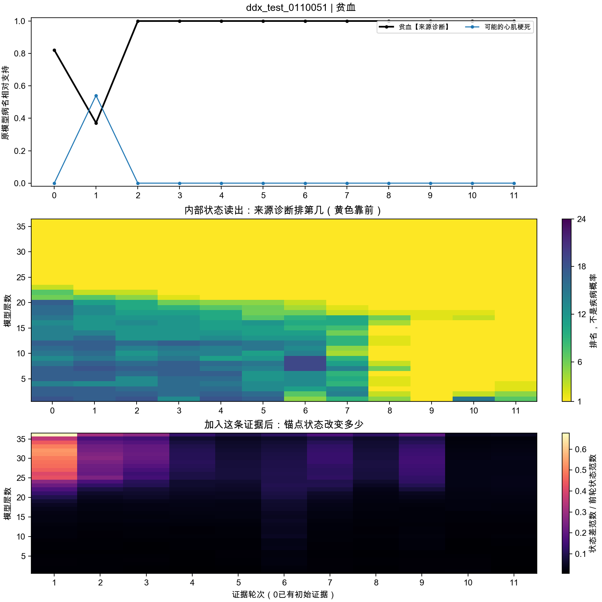

# ddx_test_0110051：贫血

DDxPlus test 原始第110051行（零起始）。轨迹类型：曾离开来源病，最后回来。来源诊断适用于完整病例；中间轮没有逐轮医学标准答案。

| 轮 | 原模型首选（49病） | 来源诊断相对支持 | 第18层读出（24病） | 第27层读出（24病） | 第36层读出（24病） |
|---|---|---:|---|---|---|
| 0 | 贫血 | 0.8215 | 重症肌无力 | 贫血 | 贫血 |
| 1 | 可能的心肌梗死 | 0.3715 | 吉兰-巴雷综合征 | 贫血 | 贫血 |
| 2 | 贫血 | 0.9998 | 吉兰-巴雷综合征 | 贫血 | 贫血 |
| 3 | 贫血 | 1.0000 | 吉兰-巴雷综合征 | 贫血 | 贫血 |
| 4 | 贫血 | 1.0000 | 心房颤动 | 贫血 | 贫血 |
| 5 | 贫血 | 1.0000 | 吉兰-巴雷综合征 | 贫血 | 贫血 |
| 6 | 贫血 | 1.0000 | 心包炎 | 贫血 | 贫血 |
| 7 | 贫血 | 1.0000 | 胰腺肿瘤 | 贫血 | 贫血 |
| 8 | 贫血 | 1.0000 | 胰腺肿瘤 | 贫血 | 贫血 |
| 9 | 贫血 | 1.0000 | 胰腺肿瘤 | 贫血 | 贫血 |
| 10 | 贫血 | 1.0000 | 胰腺肿瘤 | 贫血 | 贫血 |
| 11 | 贫血 | 1.0000 | 贫血 | 贫血 | 贫血 |

## 原始证据

**第0轮** E_89

持续疲劳或睡眠不能恢复精力：是

- Do you constantly feel fatigued or do you have non-restful sleep? **Yes**

**第1轮** E_140

近期有黑色如煤的粪便：是

- Have you recently had stools that were black (like coal)? **Yes**

**第2轮** E_76

轻微头晕或头重脚轻：是

- Do you feel slightly dizzy or lightheaded? **Yes**

**第3轮** E_208

BMI低于18.5或体重过低：是

- Is your BMI less than 18.5, or are you underweight? **Yes**

**第4轮** E_113

患慢性肾衰竭：是

- Do you have chronic kidney failure? **Yes**

**第5轮** E_88

疲劳到无法日常活动或整日卧床：是

- Do you feel so tired that you are unable to do your usual activities or are you stuck in your bed all day long? **Yes**

**第6轮** E_53

本次就诊相关疼痛（同时揭示性质、位置、程度、放射等记录）：是；疼痛性质：sensitive; a cramp；疼痛部位：top of the head; temple(R); temple(L)；疼痛强度记录：原始量表值3（0–10，端点含义未给出）；疼痛放射部位：nowhere；疼痛定位精确度记录：原始量表值7（0–10，端点含义未给出）；疼痛起病速度记录：原始量表值2（0–10，端点含义未给出）

- Do you have pain somewhere, related to your reason for consulting? **Yes**
- Characterize your pain: **sensitive; a cramp**
- Do you feel pain somewhere? **top of the head; temple(R); temple(L)**
- How intense is the pain? **Recorded scale value 3 on the dataset's 0-10 scale; endpoint meanings are unspecified**
- Does the pain radiate to another location? **nowhere**
- How precisely is the pain located? **Recorded scale value 7 on the dataset's 0-10 scale; endpoint meanings are unspecified**
- How fast did the pain appear? **Recorded scale value 2 on the dataset's 0-10 scale; endpoint meanings are unspecified**

**第7轮** E_26

家人被诊断为贫血：是

- Do you have any family members who have been diagnosed with anemia? **Yes**

**第8轮** E_82

头晕或感觉即将晕倒：是

- Do you feel lightheaded and dizzy or do you feel like you are about to faint? **Yes**

**第9轮** E_24

曾被诊断为贫血：是

- Have you ever had a diagnosis of anemia? **Yes**

**第10轮** E_7

饮食欠佳：是

- Do you have a poor diet? **Yes**

**第11轮** E_204

近四周出国旅行：否

- Have you traveled out of the country in the last 4 weeks? **No**
