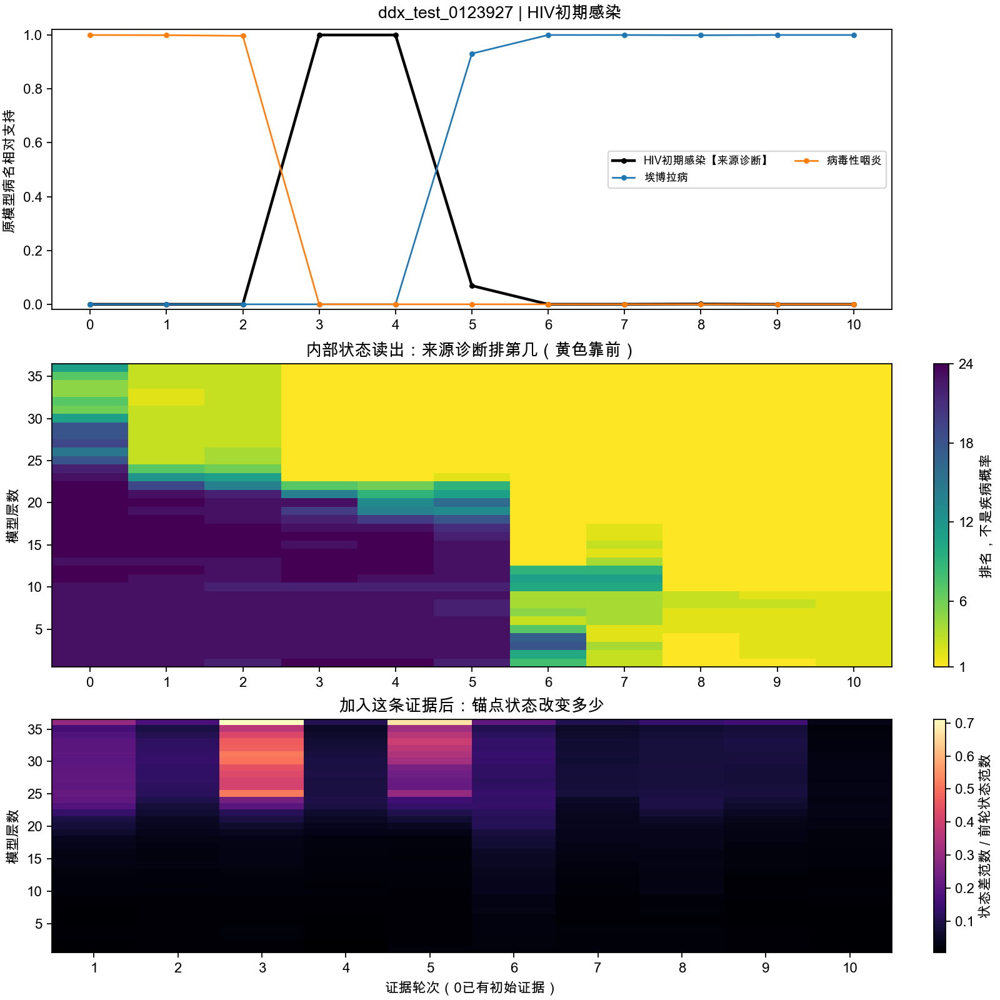

# ddx_test_0123927：HIV初期感染

DDxPlus test 原始第123927行（零起始）。轨迹类型：曾选来源病，最后离开。来源诊断适用于完整病例；中间轮没有逐轮医学标准答案。

| 轮 | 原模型首选（49病） | 来源诊断相对支持 | 第18层读出（24病） | 第27层读出（24病） | 第36层读出（24病） |
|---|---|---:|---|---|---|
| 0 | 病毒性咽炎 | 0.0000 | 重症肌无力 | 病毒性咽炎 | 病毒性咽炎 |
| 1 | 病毒性咽炎 | 0.0000 | 心房颤动 | 病毒性咽炎 | 病毒性咽炎 |
| 2 | 病毒性咽炎 | 0.0000 | 支气管痉挛/哮喘急性发作 | 病毒性咽炎 | 病毒性咽炎 |
| 3 | HIV初期感染 | 1.0000 | 支气管痉挛/哮喘急性发作 | HIV初期感染 | HIV初期感染 |
| 4 | HIV初期感染 | 1.0000 | 支气管痉挛/哮喘急性发作 | HIV初期感染 | HIV初期感染 |
| 5 | 埃博拉病 | 0.0692 | 支气管痉挛/哮喘急性发作 | HIV初期感染 | HIV初期感染 |
| 6 | 埃博拉病 | 0.0000 | HIV初期感染 | HIV初期感染 | HIV初期感染 |
| 7 | 埃博拉病 | 0.0001 | HIV初期感染 | HIV初期感染 | HIV初期感染 |
| 8 | 埃博拉病 | 0.0009 | HIV初期感染 | HIV初期感染 | HIV初期感染 |
| 9 | 埃博拉病 | 0.0000 | HIV初期感染 | HIV初期感染 | HIV初期感染 |
| 10 | 埃博拉病 | 0.0000 | HIV初期感染 | HIV初期感染 | HIV初期感染 |

## 原始证据

**第0轮** E_97

咽痛：是

- Do you have a sore throat? **Yes**

**第1轮** E_27

曾患性传播感染：是

- Have you ever had a sexually transmitted infection? **Yes**

**第2轮** E_50

出汗明显增多：是

- Have you had significantly increased sweating? **Yes**

**第3轮** E_189

过去12个月与HIV阳性伴侣有性行为：是

- Have you had sexual intercourse with an HIV-positive partner in the past 12 months? **Yes**

**第4轮** E_61

目前使用静脉注射毒品：是

- Are you currently using intravenous drugs? **Yes**

**第5轮** E_204

近四周出国旅行：West Africa

- Have you traveled out of the country in the last 4 weeks? **West Africa**

**第6轮** E_129

有自认为与本次就诊相关的皮肤问题（同时揭示颜色、位置、程度等记录）：是；皮疹颜色：pale；皮损脱屑：否；皮疹肿胀程度记录：原始量表值4（0–10，端点含义未给出）；皮损部位：lower gum; upper gum; labia majora(R); labia majora(L); internal cheek(R)；How intense is the pain caused by the rash?：原始量表值2（0–10，端点含义未给出）；皮损大于1厘米：是；瘙痒程度记录：原始量表值0（0–10，端点含义未给出）

- Do you have any lesions, redness or problems on your skin that you believe are related to the condition you are consulting for? **Yes**
- What color is the rash? **pale**
- Do your lesions peel off? **No**
- Is the rash swollen? **Recorded scale value 4 on the dataset's 0-10 scale; endpoint meanings are unspecified**
- Where is the affected region located? **lower gum; upper gum; labia majora(R); labia majora(L); internal cheek(R)**
- How intense is the pain caused by the rash? **Recorded scale value 2 on the dataset's 0-10 scale; endpoint meanings are unspecified**
- Is the lesion (or are the lesions) larger than 1cm? **Yes**
- How severe is the itching? **Recorded scale value 0 on the dataset's 0-10 scale; endpoint meanings are unspecified**

**第7轮** E_91

发热：是

- Do you have a fever (either felt or measured with a thermometer)? **Yes**

**第8轮** E_53

本次就诊相关疼痛（同时揭示性质、位置、程度、放射等记录）：是；疼痛性质：tedious; sensitive; a pulse；疼痛部位：back of head; forehead; temple(R)；疼痛强度记录：原始量表值4（0–10，端点含义未给出）；疼痛放射部位：nowhere；疼痛定位精确度记录：原始量表值3（0–10，端点含义未给出）；疼痛起病速度记录：原始量表值1（0–10，端点含义未给出）

- Do you have pain somewhere, related to your reason for consulting? **Yes**
- Characterize your pain: **tedious; sensitive; a pulse**
- Do you feel pain somewhere? **back of head; forehead; temple(R)**
- How intense is the pain? **Recorded scale value 4 on the dataset's 0-10 scale; endpoint meanings are unspecified**
- Does the pain radiate to another location? **nowhere**
- How precisely is the pain located? **Recorded scale value 3 on the dataset's 0-10 scale; endpoint meanings are unspecified**
- How fast did the pain appear? **Recorded scale value 1 on the dataset's 0-10 scale; endpoint meanings are unspecified**

**第9轮** E_9

淋巴结肿大或疼痛：是

- Do you have swollen or painful lymph nodes? **Yes**

**第10轮** E_144

广泛肌肉疼痛：是

- Do you have diffuse (widespread) muscle pain? **Yes**
