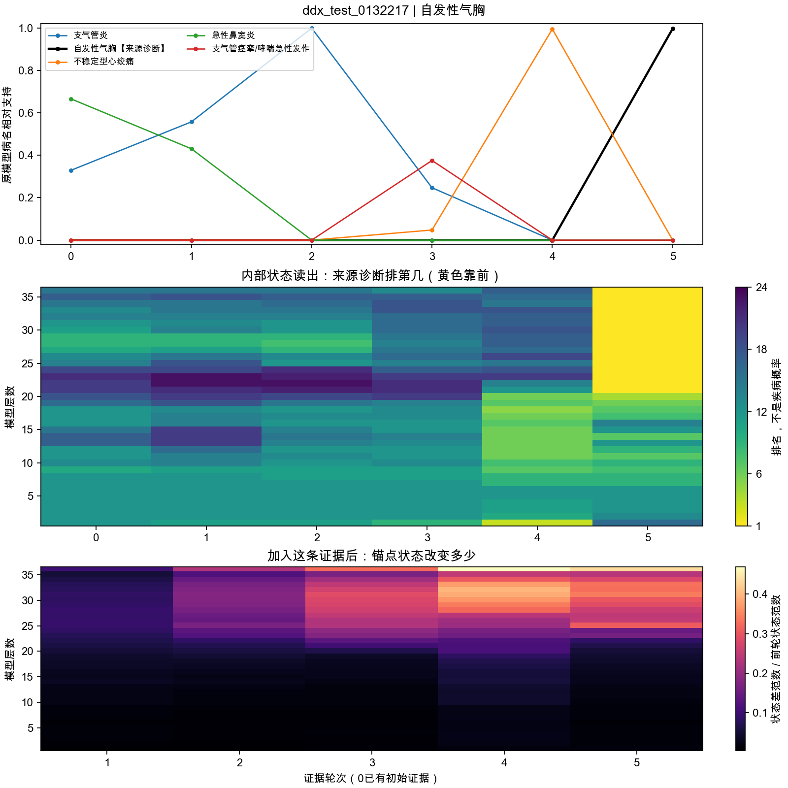

# ddx_test_0132217：自发性气胸

DDxPlus test 原始第132217行（零起始）。轨迹类型：转向来源病后保持。来源诊断适用于完整病例；中间轮没有逐轮医学标准答案。

| 轮 | 原模型首选（49病） | 来源诊断相对支持 | 第18层读出（24病） | 第27层读出（24病） | 第36层读出（24病） |
|---|---|---:|---|---|---|
| 0 | 急性鼻窦炎 | 0.0000 | 重症肌无力 | 心包炎 | 支气管炎 |
| 1 | 支气管炎 | 0.0000 | 重症肌无力 | 心包炎 | 心包炎 |
| 2 | 支气管炎 | 0.0000 | 重症肌无力 | 支气管痉挛/哮喘急性发作 | 支气管痉挛/哮喘急性发作 |
| 3 | 支气管痉挛/哮喘急性发作 | 0.0000 | 重症肌无力 | 支气管痉挛/哮喘急性发作 | 稳定型心绞痛 |
| 4 | 不稳定型心绞痛 | 0.0000 | 急性中耳炎 | 心包炎 | 稳定型心绞痛 |
| 5 | 自发性气胸 | 0.9970 | 丛集性头痛 | 自发性气胸 | 自发性气胸 |

## 原始证据

**第0轮** E_218

活动时症状加重、休息时缓解：是

- Do you have symptoms that are increased with physical exertion but alleviated with rest? **Yes**

**第1轮** E_204

近四周出国旅行：否

- Have you traveled out of the country in the last 4 weeks? **No**

**第2轮** E_79

吸烟：是

- Do you smoke cigarettes? **Yes**

**第3轮** E_14

休息时也有胸痛：是

- Do you have chest pain even at rest? **Yes**

**第4轮** E_53

本次就诊相关疼痛（同时揭示性质、位置、程度、放射等记录）：是；疼痛性质：a knife stroke；疼痛部位：breast(R); breast(L)；疼痛强度记录：原始量表值6（0–10，端点含义未给出）；疼痛放射部位：nowhere；疼痛定位精确度记录：原始量表值5（0–10，端点含义未给出）；疼痛起病速度记录：原始量表值7（0–10，端点含义未给出）

- Do you have pain somewhere, related to your reason for consulting? **Yes**
- Characterize your pain: **a knife stroke**
- Do you feel pain somewhere? **breast(R); breast(L)**
- How intense is the pain? **Recorded scale value 6 on the dataset's 0-10 scale; endpoint meanings are unspecified**
- Does the pain radiate to another location? **nowhere**
- How precisely is the pain located? **Recorded scale value 5 on the dataset's 0-10 scale; endpoint meanings are unspecified**
- How fast did the pain appear? **Recorded scale value 7 on the dataset's 0-10 scale; endpoint meanings are unspecified**

**第5轮** E_165

家人曾有气胸：是

- Have any of your family members ever had a pneumothorax? **Yes**
