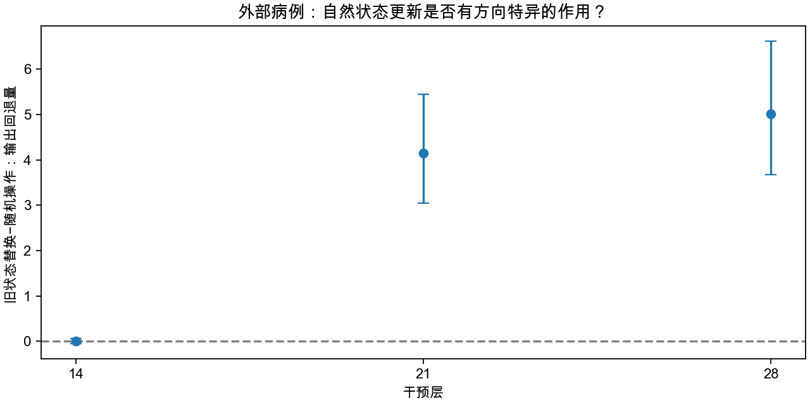

# 外部病例：新证据引起的内部状态变化，是否参与诊断？

**第21、28层的旧状态替换，比等范数随机操作更强地抵消自然诊断更新。**

87道MedQA题全部纳入，在预定中间轮的第14、21、28层，将诊断锚点换回前一轮状态，保持新证据输入和其他位置状态不变。对照为等范数且与自然状态差正交的随机改动，以及零改动。共783条件。

| 层 | 旧状态替换比随机操作多造成的回退 | 三层Holm校正p | 旧状态改变首选 | 随机改动改变首选 |
|---|---|---:|---:|---:|
| 14 | 0.0024 [-0.0511, 0.0543] | 0.9276 | 0/87 | 0/87 |
| 21 | 4.1495 [3.0489, 5.4432] | 0.0001 | 13/87 | 0/87 |
| 28 | 5.0182 [3.6681, 6.6199] | 0.0001 | 17/87 | 1/87 |

回退方向相对于模型原来的病对分差更新定义。正值表示抵消更新，未要求原更新一定指向来源答案。零干预最大log概率误差为0.000000。

这里替换整个局部状态差，没有使用DDxPlus的疾病读出方向。因此它检验外部来源中的自然状态作用，与DDxPlus的疾病方向特异性检验互补，不能把二者合并成同一种因果效应。

[全部条件](all_conditions.csv) · [逐题配对](paired_cases.csv) · [精确结果](summary.json)
